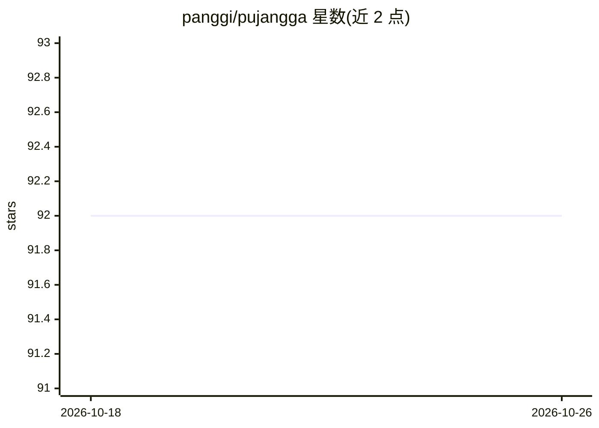

# panggi/pujangga

⭐ 92 · Scala · Apache-2.0 · 推送 2026-01-28 · [GitHub](https://github.com/panggi/pujangga) · [官网](https://panggi.github.io/pujangga/) · 个人维护

**印尼语 NLP REST API：词干提取、分词、NER 与词向量服务**

以 Scala/Play 框架实现的印尼语（Bahasa Indonesia）自然语言处理 REST 服务，作为 InaNLP 工具与 Deeplearning4j Word2Vec 的接口封装。提供词干提取（stemmer）、短语组块、词性标注、命名实体识别、口语正式化、停用词去除、句子切分等端点，并暴露 Word2Vec 最近词、向量算术与相似度计算。需本地安装 Scala 2.12.2 与 Lightbend Activator，从源码运行，并下载预训练 word2vec 模型（Google Drive 提供）。

## 筛选速览

| 维度 | 判定 | 备注 |
|---|---|---|
| AI 角色 | `ai-native` | 本体是模型或模型工具 |
| 许可风险 | `permissive` | Apache-2.0 |
| 部署形态 | `None` |  |
| 模型依赖 | — | README 未给出锁定关系 |
| 硬件要求 | — | 无带数字的原话,不猜 |
| 安装摩擦 | `low` | 无编译、无系统依赖或容器化 |
| 成熟度 | — | 结构信号不足 |

## 能力要点

- InaNLP 与 DL4J Word2Vec 的 REST API 封装
- 覆盖词干提取、词性标注、命名实体识别、口语正式化等 11 个端点
- Word2Vec 最近词、向量算术与相似度接口

## 适用场景

- 为应用提供印尼语文本处理的 HTTP 接口
- 查询印尼语词向量的相似词与相似度
- 将印尼俚语/口语文本正式化为标准表达

## 场景标签

`语义搜索` · 领域:知识与检索

## 证据(README 行号)

> L4: An interface for InaNLP and Deeplearning4j's Word2Vec for Indonesian (Bahasa Indonesia) in the form of REST API.
> L46: ### Stemmer
> L235: ### Word2Vec Nearest Words

## 星数曲线

2026-10-18 92 → 2026-10-26 92（+0）

---
*卡片 v1 · prompt 1.4 · 生成 2026-10-23 · 置信度 high · 依据 README sha `93303a8b18cd` · [字段定义](../../DATASET.md)*
