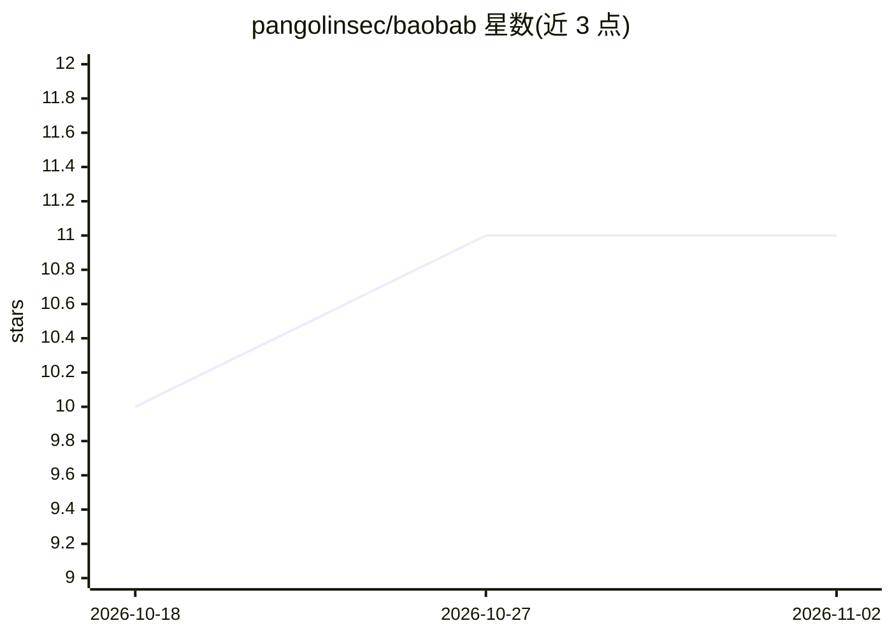

# pangolinsec/baobab

⭐ 11 · TypeScript · 推送 2026-06-16 · [GitHub](https://github.com/pangolinsec/baobab) · [官网](https://pangolinsec.github.io/baobab/) · 组织维护

**树状分支对话的浏览器端 LLM 客户端，多供应商接入**

完全在浏览器中运行的独立 Web 应用，直接调用 LLM API，无需后端。对话以节点-边图渲染，可从任意助手回复处分支探索多条线程，每条分支保留根到叶的线性上下文。支持 Anthropic、OpenAI、Azure Foundry、Gemini、OpenRouter、Hugging Face 与本地 Ollama，含推理块管理/注入、模型与系统提示级联、研究 agent、项目知识库与逐条消息成本追踪。通过 Docker Compose 运行，数据持久化在 IndexedDB。

## 筛选速览

| 维度 | 判定 | 备注 |
|---|---|---|
| AI 角色 | `ai-ecosystem` | LLM/agent 周边工具 |
| 许可风险 | `none` | — |
| 部署形态 | `self-host` | docker 或自建部署 |
| 模型依赖 | local-ok | 支持本地模型 |
| 硬件要求 | — | 无带数字的原话,不猜 |
| 安装摩擦 | `low` | 无编译、无系统依赖或容器化 |
| 成熟度 | — | 结构信号不足 |

## 能力要点

- 从任意助手节点分支，分支保留根到叶线性上下文
- 支持 Anthropic/OpenAI/Azure/Gemini/OpenRouter/HuggingFace/Ollama 七类供应商及 API key 管理
- 推理块查看/复制/注入，支持 Anthropic extended thinking 与 OpenAI/Azure 加密推理往返
- plan-and-execute 研究 agent 与项目知识文件上下文注入

## 适用场景

- 红队测试中分支探索多轮对话与推理注入转向
- 对比不同模型或系统提示在同一对话树上的表现
- 以树状结构组织多线程探索式对话

## 场景标签

`聊天机器人` · 领域:对话与助手

## 证据(README 行号)

> L5: A tree-based conversation UI for LLMs. Branch from any response to explore multiple threads of thought, with full li
> L7: Built as a standalone web app that calls LLM APIs directly from the browser — no backend required for core functiona

## 星数曲线

2026-10-18 10 → 2026-11-02 11（+1）

---
*卡片 v1 · prompt 1.4 · 生成 2026-11-01 · 置信度 high · 依据 README sha `17d058b121b0` · [字段定义](../../DATASET.md)*
