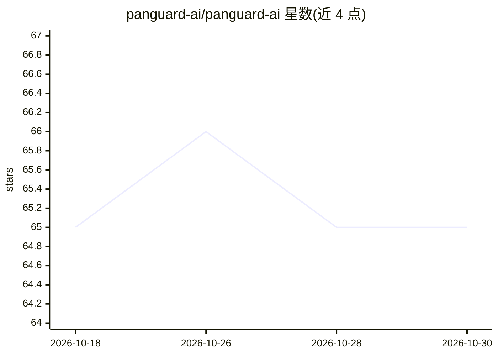

# panguard-ai/panguard-ai

⭐ 65 · TypeScript · MIT · 推送 2026-10-28 · [GitHub](https://github.com/panguard-ai/panguard-ai) · [官网](https://panguard.ai) · 个人维护 · 中文 README

**给 AI agent 的本地安全防护平台：装前审计 skill、运行时拦截工具调用**

面向安装第三方 skill 与 MCP server 的 AI agent 使用者：一条命令用 747 条开源 ATR 规则扫描已装 skill，部署本地守护进程检查 agent 的每次工具调用（覆盖 Claude Code、Cursor、Codex 等 7 平台）并在恶意行为前拦截，附本地仪表盘与一键隔离。检测以正则/AST 规则引擎在本地完成（<50ms），可选接入自备 LLM（本地 Ollama 或云 API）仅做复核不自动拦截；威胁情报共享默认关闭、需手动开启。MIT 许可，npm 全局安装，另提供 panguard.ai 在线扫描。

## 筛选速览

| 维度 | 判定 | 备注 |
|---|---|---|
| AI 角色 | `ai-ecosystem` | LLM/agent 周边工具 |
| 许可风险 | `permissive` | MIT |
| 部署形态 | `library` | 以包/库形式分发 |
| 模型依赖 | local-ok | 支持本地模型 |
| 硬件要求 | — | 无带数字的原话,不猜 |
| 安装摩擦 | `low` | 无编译、无系统依赖或容器化 |
| 成熟度 | — | 结构信号不足 |

## 能力要点

- 747 条 ATR 规则的装前扫描与 CI 门禁（SARIF 2.1.0 输出、非零退出码）
- 本地守护进程拦截 7 个平台 agent 的 MCP 与内置工具调用
- 确定性检测为主（正则/AST，<50ms，离线可用），可选 LLM 仅复核不拦截
- 威胁情报共享 opt-in 且经 ed25519 签名验证、fail-closed

## 适用场景

- 安装来源不明的 skill 或 MCP server 前先做风险审计
- 在 CI 中用 SARIF 输出拦截恶意 skill 合入
- 持续监控本机 AI agent 的工具调用并一键隔离威胁

## 场景标签

`网络安全` · 领域:学习与行业

## 证据(README 行号)

> L15: PanGuard is that check. One command scans every skill your agents installed against **747 open ATR rules**, drops a
> L32: - **Runtime guard** — a local daemon inspects every agent tool call — both MCP servers and the agent's _own_ built-
> L34: - **Deterministic + explainable** — the blocking is regex/AST + ATR rules, on-device, sub-50ms. An optional LLM "se

## 星数曲线

2026-10-18 65 → 2026-10-30 65（+0）

---
*卡片 v1 · prompt 1.4 · 生成 2026-10-24 · 置信度 high · 依据 README sha `ac416e6b0750` · [字段定义](../../DATASET.md)*
