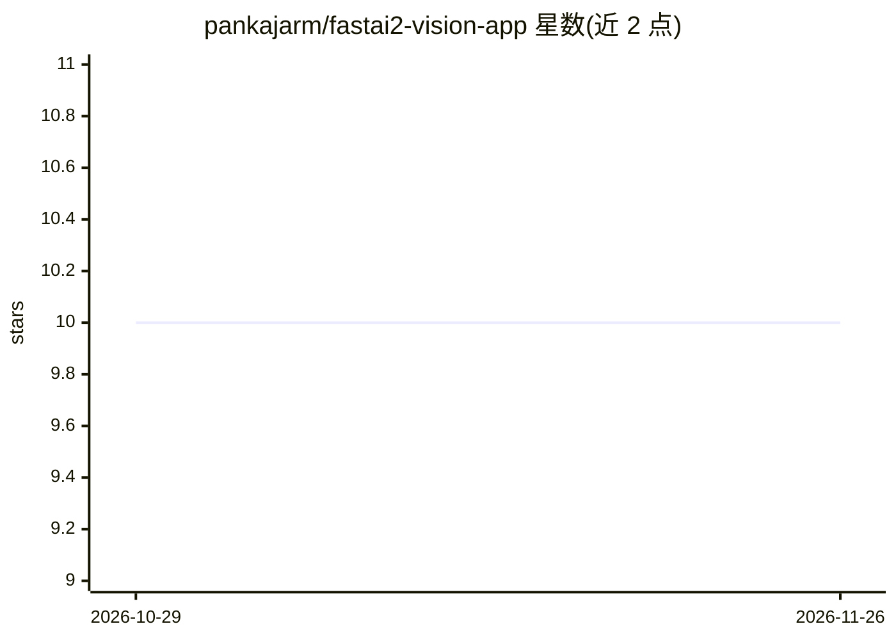

# pankajarm/fastai2-vision-app

⭐ 10 · CSS · MIT · 推送 2026-10-27 · [GitHub](https://github.com/pankajarm/fastai2-vision-app) · 个人维护

**fastai2 视觉模型的 Web 应用部署模板**

面向 fastai2 视觉模型的部署就绪起始模板：使用 Starlette 框架与 Uvicorn ASGI 服务器将训练好的模型封装为响应式 Web 应用，并以 Docker 镜像形式打包（含 requirement.txt），可推送到任意支持 Docker 托管的云服务运行。提供本地构建与运行命令用于测试更改。

## 筛选速览

| 维度 | 判定 | 备注 |
|---|---|---|
| AI 角色 | `ai-native` | 本体是模型或模型工具 |
| 许可风险 | `permissive` | MIT |
| 部署形态 | `self-host` | docker 或自建部署 |
| 模型依赖 | — | README 未给出锁定关系 |
| 硬件要求 | — | 无带数字的原话,不猜 |
| 安装摩擦 | `low` | 无编译、无系统依赖或容器化 |
| 成熟度 | — | 结构信号不足 |

## 能力要点

- fastai2 视觉模型的部署就绪模板
- 基于 Starlette 框架与 Uvicorn ASGI 服务器
- 以 Docker 打包并附 requirement.txt，可推送至任意 Docker 托管云服务
- 提供本地 docker build/run 测试命令

## 适用场景

- 将 fastai2 训练的视觉模型部署为在线 Web 应用
- 把模型服务推送到 Render、Azure 等支持 Docker 的云平台
- 在本地用 Docker 测试模型服务后再部署

## 场景标签

 · 领域:机器学习/模型部署

## 证据(README 行号)

> L5: Deployment ready starter pack template for creating fast responsive Web App for fastai2 Vision models using Starlett
> L7: Everything packaged in docker with requirement.txt, so you can push it to any docker hosted cloud service. Enjoy :)

## 星数曲线

2026-10-29 10 → 2026-11-26 10（+0）

---
*卡片 v1 · prompt 1.4 · 生成 2026-11-19 · 置信度 mid · 依据 README sha `2e2f3f0a8d41` · [字段定义](../../DATASET.md)*
