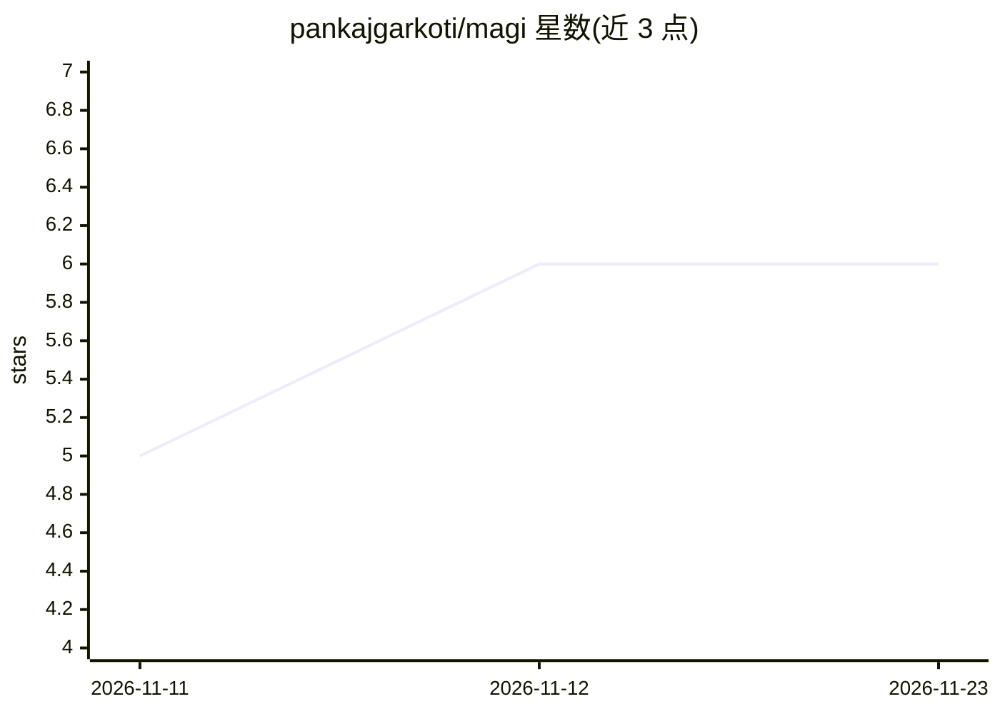

# pankajgarkoti/magi

⭐ 6 · Python · MIT · 推送 2026-11-17 · [GitHub](https://github.com/pankajgarkoti/magi) · [官网](https://computerreinvention.com) · 个人维护

**围绕 LLM agent 编排的 Fedora/Hyprland 桌面环境配置**

以 tmux 中运行的编排 agent 为主要界面的 Fedora/Hyprland 桌面环境：编排 agent 可启动其他 agent、通过 hyprctl 操作桌面、仅在需要决策时询问用户。核心机制包括事件总线（orch-bus 单行事件投递）、SQLite 台账跨重启记录 agent 与线程、基于 faster-whisper 与 Piper 的离线语音输入输出、chrome-devtools MCP 驱动的 agent 浏览器。agent 本体不随镜像捆绑，首次登录时由 PILOT SETUP 运行所选 agent 的官方安装器。

## 筛选速览

| 维度 | 判定 | 备注 |
|---|---|---|
| AI 角色 | `ai-ecosystem` | LLM/agent 周边工具 |
| 许可风险 | `permissive` | MIT |
| 部署形态 | `library` | 以包/库形式分发 |
| 模型依赖 | locked-api |  |
| 硬件要求 | — | 无带数字的原话,不猜 |
| 安装摩擦 | `low` | 无编译、无系统依赖或容器化 |
| 成熟度 | — | 结构信号不足 |

## 能力要点

- 编排 agent 运行于 tmux，通过事件总线接收 worker 完成通知，无需轮询
- 事件总线 + SQLite 台账 + 每日笔记中的开放线程勾选跨重启保留状态
- faster-whisper（base.en）语音转写与 Piper 语音回复，完全离线
- 支持 Claude Code / opencode / Codex / 自定义任意终端 agent，可随时切换

## 适用场景

- 用一个编排 agent 在桌面上指挥多个终端 agent 协作
- 让 agent 代为操作 Hyprland 桌面并只回报需要决策的事项
- 离线环境下用语音与 agent 交互
- 重启后恢复 tmux 布局并续接各 agent 会话

## 场景标签

`多智能体` `语音识别` `语音 Agent` · 领域:Agent 开发

## 证据(README 行号)

> L5: mAGI is a Fedora/Hyprland setup built around LLM agents. The main interface is an agent
> L24: - **Event bus.** Anything can publish a one-line event with `orch-bus emit`: workers, scripts,
> L58: tmux is the orchestration layer, so the orchestrator and its agents can be any terminal agent.

## 星数曲线

2026-11-11 5 → 2026-11-23 6（+1）

---
*卡片 v1 · prompt 1.4 · 生成 2026-11-20 · 置信度 mid · 依据 README sha `7949c6276956` · [字段定义](../../DATASET.md)*
