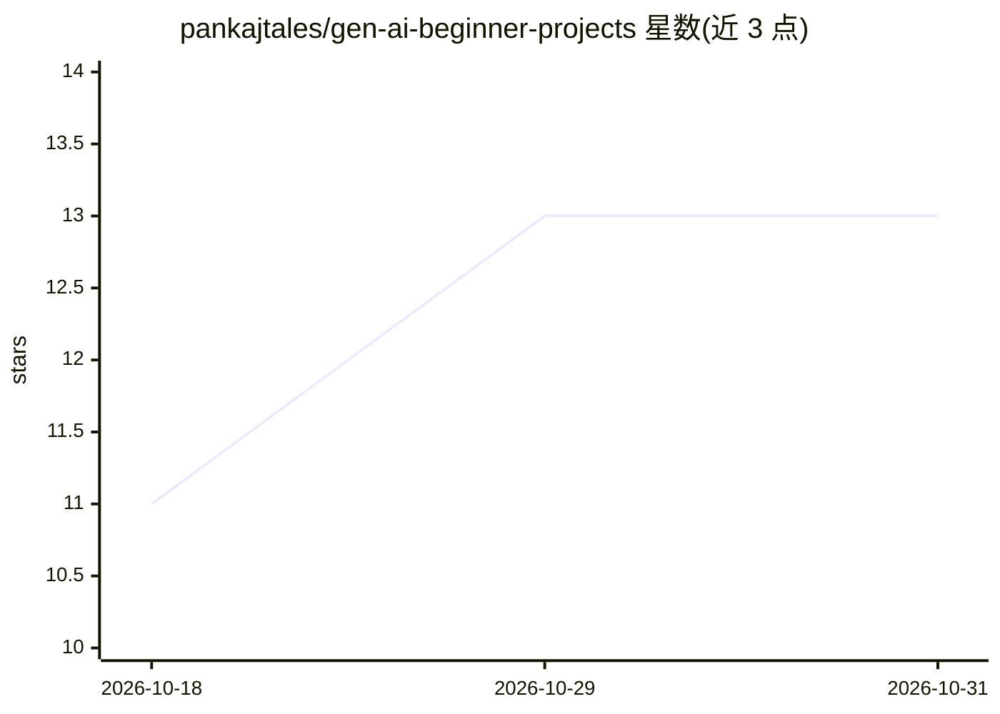

# pankajtales/gen-ai-beginner-projects

⭐ 13 · Python · MIT · 推送 2026-02-22 · [GitHub](https://github.com/pankajtales/gen-ai-beginner-projects) · 个人维护

**生成式 AI 初学者实战项目集合：动手学提示工程/RAG/Agent**

面向初学者的动手学习仓库：以 Python + Google Gemini API + LangChain 为常用技术栈，通过多个独立小项目覆盖提示工程、LLM API 调用、嵌入与语义搜索、向量数据库、RAG 与 AI Agent 等概念，每个项目聚焦一到两个核心概念。提供统一的四步环境搭建流程（clone、venv、.env 密钥、pip 安装）与运行方式，并附学习路线图、新项目模板与贡献规范。README 明确声明非生产级、仅供学习实验，LLM API 调用可能产生费用。

## 筛选速览

| 维度 | 判定 | 备注 |
|---|---|---|
| AI 角色 | `ai-knowledge` | 知识聚合/清单类 |
| 许可风险 | `permissive` | MIT |
| 部署形态 | `library` | 以包/库形式分发 |
| 模型依赖 | — | README 未给出锁定关系 |
| 硬件要求 | — | 无带数字的原话,不猜 |
| 安装摩擦 | `low` | 无编译、无系统依赖或容器化 |
| 成熟度 | — | 结构信号不足 |

## 能力要点

- 覆盖提示工程/LLM API/嵌入/向量库/RAG/Agent 六类主题的独立小项目
- 统一环境搭建流程（venv + .env 密钥 + pip install）与项目模板
- 附 Generative AI 学习路线图（Mermaid）与学习资源清单

## 适用场景

- 初学者通过小项目逐步上手生成式 AI 概念
- 开发者转岗 AI/ML 前搭建作品集练手项目
- 按模板添加并分享自己的 GenAI 实验

## 场景标签

`教程课程` `提示工程` `RAG` · 领域:Agent 开发

## 证据(README 行号)

> L3: Welcome to **Gen AI Beginner Projects**👋 - a hands-on learning repository designed to help you understand the fundam
> L24: This repository contains **small, focused Gen AI projects**, each living in its own folder, designed to:
> L34: ⚠️ This repo is **not production-ready**.

## 星数曲线

2026-10-18 11 → 2026-10-31 13（+2）

---
*卡片 v1 · prompt 1.4 · 生成 2026-10-31 · 置信度 high · 依据 README sha `1c3d4a75516a` · [字段定义](../../DATASET.md)*
