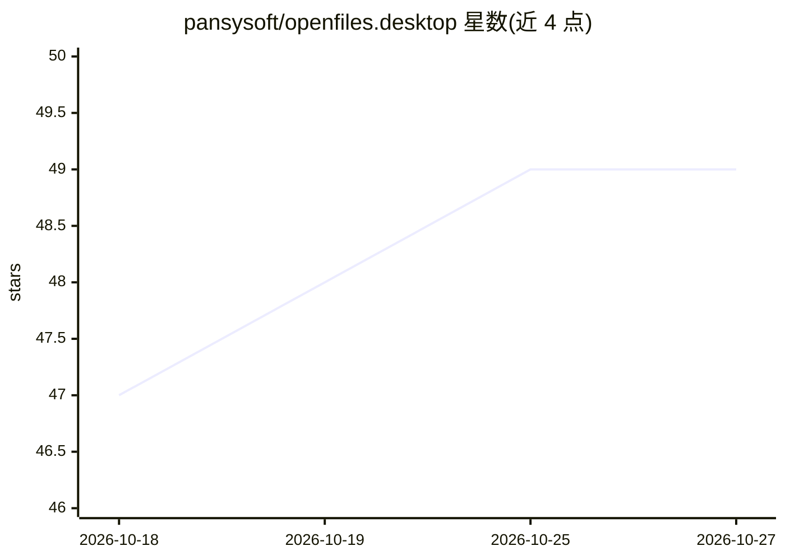

# pansysoft/openfiles.desktop

⭐ 49 · 推送 2026-10-16 · [GitHub](https://github.com/pansysoft/openfiles.desktop) · [官网](https://openfiles.pansysoft.app/) · 组织维护 · 中文 README

**面向 Windows/macOS 的 AI 文件工作区：浏览、编辑 350+ 格式并配合 AI 处理**

桌面端文件工作区，支持打开/预览 350 余种格式（图片、文档、表格、音视频、CAD、压缩包等），提供文档编辑、标签页与分屏多任务、可复用的 .ofw 批处理工作流，并可接入 AI 助手对话文件、生成图像/视频/音频。AI 部分可使用内置 OpenFiles 服务（OFD 积分计费）或自配 provider，另含背景移除、 inpainting、超分等本地 AI 节点（需下载运行时与模型）。本地浏览与编辑无需 AI provider。仓库仅发布桌面安装包与产品信息，不含源码；Linux 包未发布。

## 筛选速览

| 维度 | 判定 | 备注 |
|---|---|---|
| AI 角色 | `ai-enhanced` | 去掉 AI 部分产品仍成立 |
| 许可风险 | `none` | — |
| 部署形态 | `desktop` | 安装包/桌面程序 |
| 模型依赖 | — | README 未给出锁定关系 |
| 硬件要求 | — | 无带数字的原话,不猜 |
| 安装摩擦 | `low` | 无编译、无系统依赖或容器化 |
| 成熟度 | — | 结构信号不足 |

## 能力要点

- 350+ 文件格式的浏览、预览与编辑（含 RAW、OFD、CAD、点云等）
- 可复用 .ofw 批处理工作流（RAW 转 JPG、Live Photo 提取等）
- AI 对话文件与图像/视频/音频生成，支持内置服务或自配 provider
- 背景移除、inpainting、超分等本地 AI 节点

## 适用场景

- 在一个应用里替代多个格式查看器打开日常与专业文件
- 用批处理工作流批量转换或整理文件
- 和 AI 对话处理文件内容，或本地跑背景移除/超分

## 场景标签

`工作流自动化` `AI 助手` `图像视频处理` · 领域:效率与自动化

## 证据(README 行号)

> L5: Open, preview, and work with 350+ file formats in one desktop workspace. Browse folders, edit supported documents, a
> L55: 1. Install OpenFiles and open a folder or file. Local file browsing and viewing do not require an AI provider.

## 星数曲线

2026-10-18 47 → 2026-10-27 49（+2）

---
*卡片 v1 · prompt 1.4 · 生成 2026-10-24 · 置信度 high · 依据 README sha `92ad8cfd167d` · [字段定义](../../DATASET.md)*
