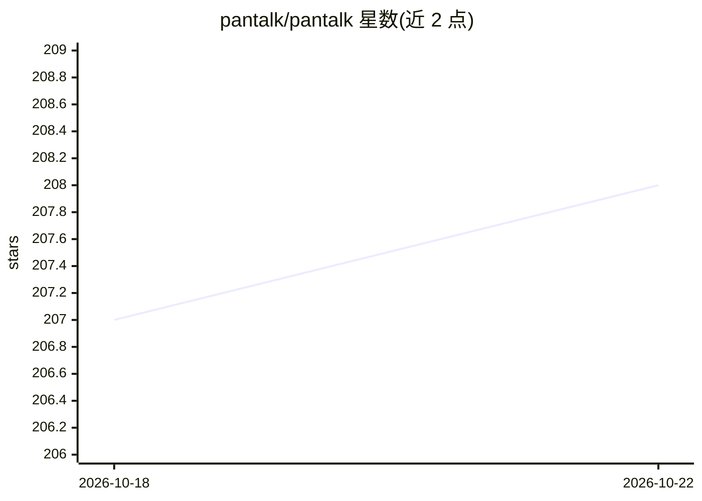

# pantalk/pantalk

⭐ 208 · Go · MIT · 推送 2026-08-13 · [GitHub](https://github.com/pantalk/pantalk) · [官网](https://pantalk.dev) · 组织维护

**把编码 Agent 接入聊天平台的守护进程，两端均可插拔**

Pantalk 是一个本地守护进程 pantalkd，把用户已有的编码 Agent（Claude Code、Codex、Kimi Code、Copilot、Gemini CLI、Goose 等）接入团队已有的聊天平台（Slack、Discord、Telegram、WhatsApp、Matrix、iMessage 等 13 种）。Agent 通过 driver 接入、平台通过 connector 接入，二者用 YAML 中的 when: 绑定关联，切换任一端只需改一行配置。提供统一 CLI、SQLite 本地持久化、按 service/bot/channel/thread/user 隔离的会话，以及内含 Codex/Claude Code 的参考镜像 Pantalk Ghost。以 Docker 镜像与二进制形式发布。

## 筛选速览

| 维度 | 判定 | 备注 |
|---|---|---|
| AI 角色 | `ai-ecosystem` | LLM/agent 周边工具 |
| 许可风险 | `permissive` | MIT |
| 部署形态 | `self-host` | docker 或自建部署 |
| 模型依赖 | — | README 未给出锁定关系 |
| 硬件要求 | — | 无带数字的原话,不猜 |
| 安装摩擦 | `low` | 无编译、无系统依赖或容器化 |
| 成熟度 | — | 结构信号不足 |

## 能力要点

- N 个 Agent harness × 13 个聊天平台，一个守护进程完成路由
- 更换 harness 或平台只需修改 YAML 中一行配置
- 基于 Unix socket 的 JSON 协议 CLI，可与 grep/jq/xargs 组合
- pantalk local 单进程模式提供零配置本地对话，SQLite 本地持久化无外部依赖

## 适用场景

- 团队在 Slack/Telegram 等频道中 @ 机器人调用 Claude Code 或 Codex 完成修 bug、开 PR
- 值班事件在 on-call 频道触发 Agent 分诊并经 Twilio/WhatsApp 通知到手机
- 一个 Agent 订阅供全团队共享，每人获得隔离会话，无需逐人安装 CLI

## 场景标签

`编码 Agent` · 领域:编码与开发

## 证据(README 行号)

> L29: Harnesses plug in on one edge. Platforms plug in on the other. `pantalkd` sits
> L185: - **Both ends pluggable** - harnesses attach through drivers, platforms through connectors; neither knows about th

## 星数曲线

2026-10-18 207 → 2026-10-22 208（+1）

---
*卡片 v1 · prompt 1.4 · 生成 2026-10-22 · 置信度 high · 依据 README sha `2002383b2ca3` · [字段定义](../../DATASET.md)*
