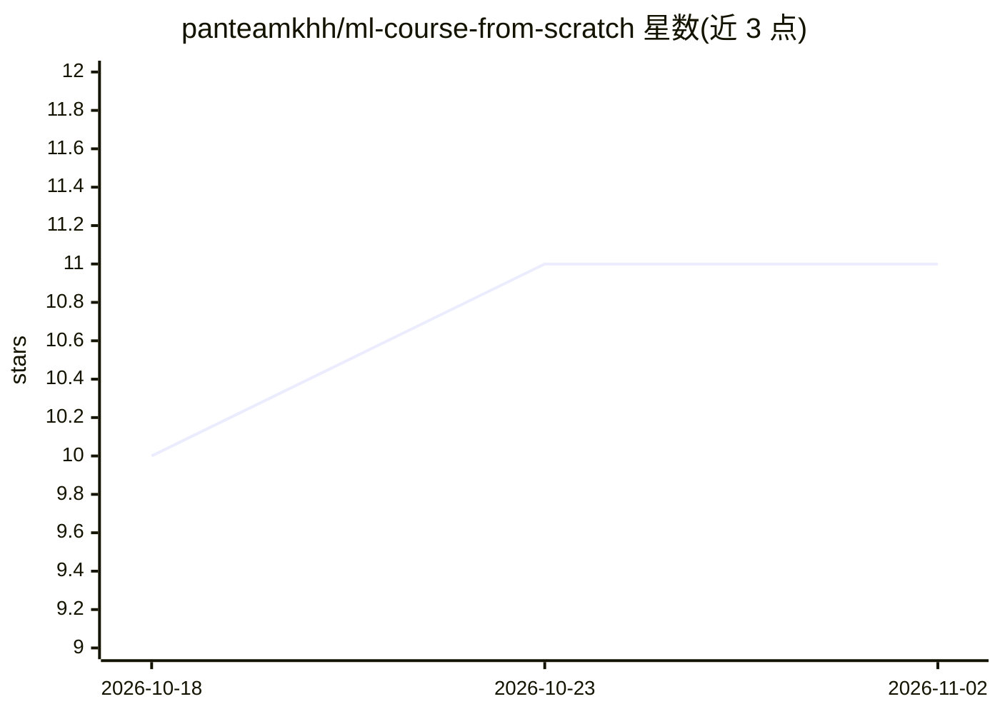

# panteamkhh/ml-course-from-scratch

⭐ 11 · Jupyter Notebook · NOASSERTION · 推送 2026-09-13 · [GitHub](https://github.com/panteamkhh/ml-course-from-scratch) · 个人维护

**14 天从零实现机器学习算法的代码优先课程仓库**

配合 Hal Daumé III《A Course in Machine Learning》教材的 14 天代码优先教学仓库：每天用纯 NumPy 从零实现一个算法（决策树、感知机、线性模型、神经网络、核方法等），在真实数据集上运行，并与 scikit-learn 参考实现做正确性对照，输出一致率与指标比较。每天配有英文指南 en.md 与可端到端运行的 Jupyter notebook，固定随机种子保证可复现。需 Python 3.9+ 与 numpy/scipy/scikit-learn，git clone 后按章运行脚本。

## 筛选速览

| 维度 | 判定 | 备注 |
|---|---|---|
| AI 角色 | `ai-knowledge` | 知识聚合/清单类 |
| 许可风险 | `none` | NOASSERTION |
| 部署形态 | `None` |  |
| 模型依赖 | — | README 未给出锁定关系 |
| 硬件要求 | — | 无带数字的原话,不猜 |
| 安装摩擦 | `low` | 无编译、无系统依赖或容器化 |
| 成熟度 | — | 结构信号不足 |

## 能力要点

- 纯 NumPy 从零实现教材中的核心算法，不调用 model.fit()
- 每个实现与 scikit-learn 参考做正确性对照（一致率与指标）
- 14 天课程各配指南文档与端到端 notebook
- 使用真实数据集（sklearn 内置与 SMS Spam Collection），固定随机种子

## 适用场景

- 想理解机器学习算法内部原理的学习者逐日跟学
- 教学场景下作为从零实现的代码参考
- 对照手写实现与 scikit-learn 结果验证理解

## 场景标签

`教程课程` · 领域:学习与行业

## 证据(README 行号)

> L3: **A 14-day, code-first walkthrough of _A Course in Machine Learning_ by Hal Daumé III.**
> L18: Each day covers one topic from the book and follows the same recipe:
> L24: |**Correctness check**|The from-scratch model is compared against the equivalent scikit-learn implementation.|

## 星数曲线

2026-10-18 10 → 2026-11-02 11（+1）

---
*卡片 v1 · prompt 1.4 · 生成 2026-11-01 · 置信度 high · 依据 README sha `5a919465440a` · [字段定义](../../DATASET.md)*
