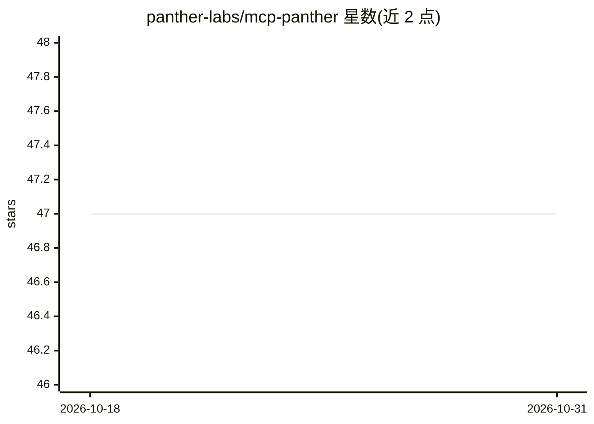

# panther-labs/mcp-panther

⭐ 47 · Python · Apache-2.0 · 推送 2026-10-27 · [GitHub](https://github.com/panther-labs/mcp-panther) · [官网](https://www.panther.com) · 组织维护

**让 AI agent 操作 Panther 安全平台的 MCP 服务器**

Panther 官方维护的 Model Context Protocol 服务器，把 Panther 安全运营平台的能力暴露给 AI agent：编写与调优检测规则、用自然语言查询数据湖日志（SQL）、告警的分诊/评论/批量状态更新，以及访问数据模型、Schema、指标、用户权限等约 40 个工具。需先在 Panther 创建 API Token 获取凭证。安装支持预构建 Docker 镜像（ghcr.io）或 uvx 从 PyPI 直接运行，支持 STDIO 与 Streamable HTTP 两种传输方式，可接入 Cursor、Claude Code、Claude Desktop、Goose 等 MCP 客户端。

## 筛选速览

| 维度 | 判定 | 备注 |
|---|---|---|
| AI 角色 | `ai-ecosystem` | LLM/agent 周边工具 |
| 许可风险 | `permissive` | Apache-2.0 |
| 部署形态 | `self-host` | docker 或自建部署 |
| 模型依赖 | — | README 未给出锁定关系 |
| 硬件要求 | — | 无带数字的原话,不猜 |
| 安装摩擦 | `low` | 无编译、无系统依赖或容器化 |
| 成熟度 | — | 结构信号不足 |

## 能力要点

- 约 40 个工具覆盖告警管理、数据湖 SQL 查询、检测规则调优、指标与用户管理
- 支持 Docker / uvx(PyPI) 两种安装方式及版本固定
- STDIO 与 Streamable HTTP 双传输，可作持久化 Web 服务多客户端共享
- 内置 AI 告警分诊工具（生成与获取智能分析摘要）

## 适用场景

- 在 IDE 中让 AI agent 编写和调优 Panther 检测规则
- 用自然语言查询安全日志与告警事件
- 让 agent 批量分诊、评论并解决安全告警

## 场景标签

`网络安全` · 领域:学习与行业

## 证据(README 行号)

> L5: Panther's Model Context Protocol (MCP) server provides functionality to:
> L7: 1. **Write and tune detections from your IDE**
> L9: 3. **Triage, comment, and resolve one or many alerts**

## 星数曲线

2026-10-18 47 → 2026-10-31 47（+0）

---
*卡片 v1 · prompt 1.4 · 生成 2026-10-25 · 置信度 high · 依据 README sha `be8f6d9b410d` · [字段定义](../../DATASET.md)*
