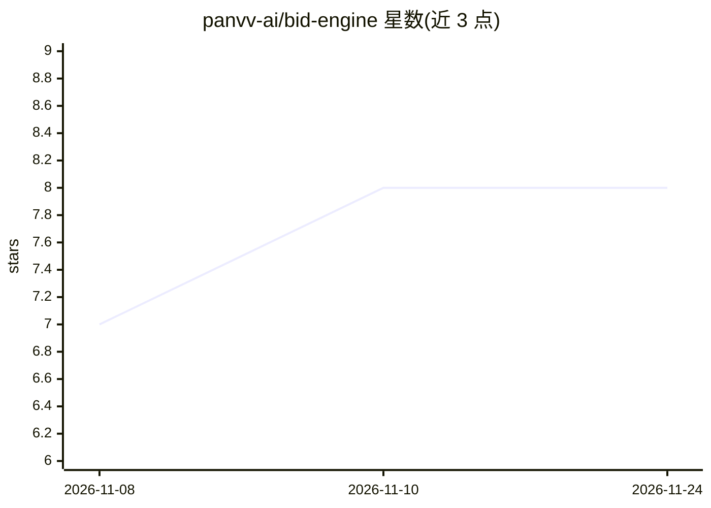

# panvv-ai/bid-engine

⭐ 8 · Go · NOASSERTION · 推送 2026-11-04 · [GitHub](https://github.com/panvv-ai/bid-engine) · 组织维护 · 中文 README

**给投标团队的全流程 AI 工作台：找标、读标、写标、审标**

覆盖招投标全链路的可私有部署工作台：招标情报站多源采集公告并订阅提醒；招标解析将 PDF/DOC 拆成带页码与坐标证据的字段、条款、风险与大纲；投标文件生成支持大纲评审、SSE 流式写作与 DOCX/PDF 导出；审核模块生成结构化清单并支持整改闭环；素材库沉淀企业资质、业绩与模板。LLM 通过 OpenAI 兼容接口按业务模块分别配置，数据服务本地部署。许可证为 PolyForm Noncommercial，限制商业使用，且仓库不含演示数据。

## 筛选速览

| 维度 | 判定 | 备注 |
|---|---|---|
| AI 角色 | `ai-native` | 本体是模型或模型工具 |
| 许可风险 | `none` | NOASSERTION |
| 部署形态 | `self-host` | docker 或自建部署 |
| 模型依赖 | — | README 未给出锁定关系 |
| 硬件要求 | — | 无带数字的原话,不猜 |
| 安装摩擦 | `low` | 无编译、无系统依赖或容器化 |
| 成熟度 | — | 结构信号不足 |

## 能力要点

- 招标解析结论保留原文页码、坐标与多处证据，可定位复核
- 标书生成支持整篇或单章 SSE 流式生成、选区 AI 重写
- 按业务模块配置 OpenAI 兼容模型的 Base URL/API Key/模型 ID
- 审核差异项可定位投标原文，整改状态与责任人闭环

## 适用场景

- 持续发现并订阅符合关注条件的公开招标公告
- 上传招标文件后解析出字段、条款、风险与标书大纲
- 基于解析结果与企业素材生成并审核标书
- 本地私有部署管理团队投标素材与审核规则

## 场景标签

`文档解析` `AI 写作` `网页抓取` · 领域:效率与自动化

## 证据(README 行号)

> L25: 标擎把分散在多个工具中的招投标工作组织成一条可追溯、可协作的链路：先持续发现值得跟进的项目，再把招标文件拆成可核验的字段、条款和风险，随后完成标书大纲、正文生成与逐项审核，并将企业素材和审核规则沉淀下来。
> L66: - 流水线覆盖文档规范化、章节识别、字段提取、条款抽取、风险评估、标书蓝图和智能摘要。
> L253: 登录后进入“系统管理 > 模型配置”，至少配置一个可用的 OpenAI 兼容服务：

## 星数曲线

2026-11-08 7 → 2026-11-24 8（+1）

---
*卡片 v1 · prompt 1.4 · 生成 2026-11-20 · 置信度 high · 依据 README sha `65ec4243450c` · [字段定义](../../DATASET.md)*
