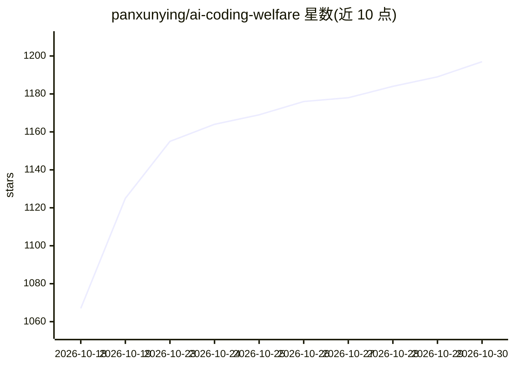

# panxunying/ai-coding-welfare

⭐ 1,197 · JavaScript · MIT · 推送 2026-10-29 · [GitHub](https://github.com/panxunying/ai-coding-welfare) · [官网](https://panxunying.github.io/ai-coding-welfare/) · 个人维护 · 中文 README

**AI 编码工具免费额度的中转/公益站导航合集**

收录 11 个提供免费 Claude Code / Codex 可用额度的 API 中转站与公益站，按表格展示在线状态、首日可得额度、兼容协议（Anthropic/OpenAI）、签到规则与邀请码；模型、价格、在线状态由脚本抓取站点公开接口自动更新。每个站点附详细条目：注册要求、实时数据、接入配置（Claude Code / Codex CLI / OpenAI SDK 环境变量与 Base URL）、公告同步与风险提示。提供 quickstart 一键脚本（macOS/Linux/Windows）交互式写好 Claude Code 环境变量。

## 筛选速览

| 维度 | 判定 | 备注 |
|---|---|---|
| AI 角色 | `ai-knowledge` | 知识聚合/清单类 |
| 许可风险 | `permissive` | MIT |
| 部署形态 | `library` | 以包/库形式分发 |
| 模型依赖 | — | README 未给出锁定关系 |
| 硬件要求 | — | 无带数字的原话,不猜 |
| 安装摩擦 | `low` | 无编译、无系统依赖或容器化 |
| 成熟度 | — | 结构信号不足 |

## 能力要点

- 11 个站点的额度、协议、签到与邀请码对照表
- 脚本自动抓取站点公开接口更新模型、价格与在线状态
- quickstart.sh / quickstart.ps1 一键配置 Claude Code 环境变量
- 每站附风险提示（计价单位、倍率、域名与稳定性）

## 适用场景

- 找免费额度跑 Claude Code / Codex 而不充值
- 对比各中转站的协议兼容、额度与签到规则
- 按站点详情页的环境变量配置接入编码客户端

## 场景标签

`精选清单` · 领域:学习与行业

## 证据(README 行号)

> L5:  免费额度 · 白嫖 Claude Code / Codex / Cursor 的中转与公益站合集
> L47: > 「首日可得」= 注册基础额度 + 本页邀请链接额度 + 当天能领的签到额度（每日重置额度池的站点按一天的池子算）；模型、价格、在线状态由脚本抓取站点公开接口自动生成，最后更新：`2026-10-19 13:20 UTC`。

## 星数曲线

2026-10-18 1,067 → 2026-10-30 1,197（+130）

---
*卡片 v1 · prompt 1.4 · 生成 2026-10-21 · 置信度 mid · 依据 README sha `fa6cc2f44d77` · [字段定义](../../DATASET.md)*
