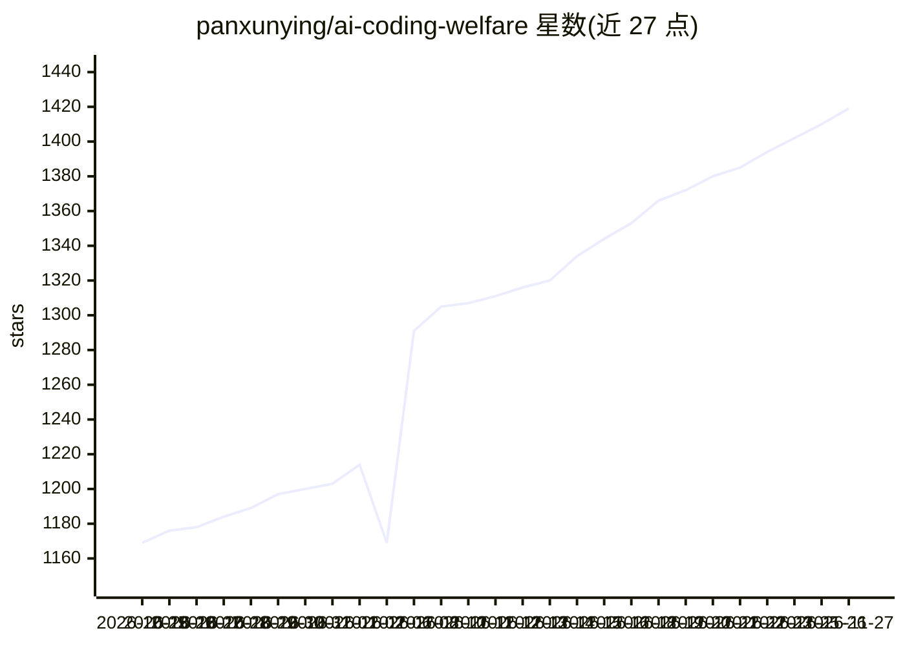

# panxunying/ai-coding-welfare

⭐ 1,419 · JavaScript · MIT · 推送 2026-11-26 · [GitHub](https://github.com/panxunying/ai-coding-welfare) · [官网](https://panxunying.github.io/ai-coding-welfare/) · 个人维护 · 中文 README

**给 AI 编程用户整理免费额度中转/公益站的导航清单**

一个导航类仓库：收录 11 个提供免费注册额度的 Claude Code / Codex 中转站与公益站，用脚本自动抓取各站公开接口生成额度、模型、在线状态表格并定时更新。为每个站点提供注册要求（GitHub 年限、LinuxDO 等级、QQ 群）、邀请码说明、环境变量接入配置与连通性自测命令，并附带 quickstart.sh / quickstart.ps1 一键写入环境变量的脚本。含风险提示章节说明站内计价单位、倍率与上游波动。

## 筛选速览

| 维度 | 判定 | 备注 |
|---|---|---|
| AI 角色 | `ai-knowledge` | 知识聚合/清单类 |
| 许可风险 | `permissive` | MIT |
| 部署形态 | `library` | 以包/库形式分发 |
| 模型依赖 | — | README 未给出锁定关系 |
| 硬件要求 | — | 无带数字的原话,不猜 |
| 安装摩擦 | `low` | 无编译、无系统依赖或容器化 |
| 成熟度 | — | 结构信号不足 |

## 能力要点

- 脚本自动抓取站点公开接口，更新额度/模型/在线状态表格
- 每个站点给出环境变量接入配置与 curl 连通性自测
- 提供 macOS/Linux 与 Windows 一键配置脚本（git clone + bash/PowerShell）
- 含折算横评、可用性历史、变动日志与 Atom 订阅

## 适用场景

- 想用免费额度跑 Claude Code / Codex 时挑选注册哪些中转站
- 按脚本一键写入环境变量接入某个站点
- 查站点倍率、注册门槛与上游波动等风险信息

## 场景标签

`精选清单` · 领域:学习与行业

## 证据(README 行号)

> L1: AI Coding 福利站导航
> L40: |站点|状态|首日可得|额度构成|之后每天|兼容协议|模型|注册|邀请码|备注|
> L54: > 「首日可得」= 注册基础额度 + 本页邀请链接额度 + 当天能领的签到额度（每日重置额度池的站点按一天的池子算）；模型、价格、在线状态由脚本抓取站点公开接口自动生成，最后更新：`2026-11-26 21:35 UTC`。

## 星数曲线

2026-10-25 1,169 → 2026-11-27 1,419（+250）

---
*卡片 v1 · prompt 1.4 · 生成 2026-11-27 · 置信度 mid · 依据 README sha `1ee4098c91b5` · [字段定义](../../DATASET.md)*
