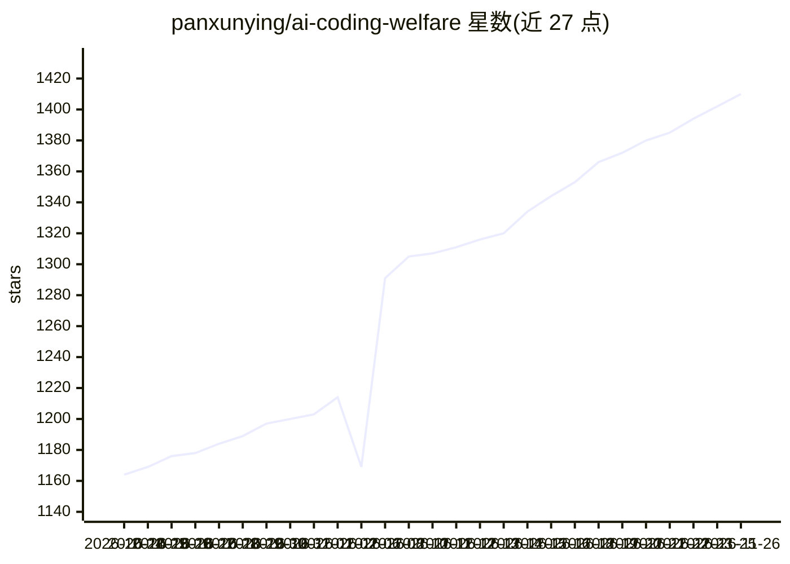

# panxunying/ai-coding-welfare

⭐ 1,410 · JavaScript · MIT · 推送 2026-11-25 · [GitHub](https://github.com/panxunying/ai-coding-welfare) · [官网](https://panxunying.github.io/ai-coding-welfare/) · 个人维护 · 中文 README

**面向 AI 编程用户的免费额度中转站导航与一键配置脚本合集**

收录 11 个提供免费额度的 API 中转站与公益站，以表格与站点详情页呈现各站额度构成、注册要求、兼容协议（Anthropic / OpenAI）、可用模型与风险提示；额度、模型、在线状态由脚本抓取站点公开接口自动更新。提供 macOS/Linux/Windows 的一键配置脚本（git clone 后运行 quickstart.sh/ps1），将站点 Base URL 与 API Key 写入 Claude Code 环境变量；详情页附 Codex CLI、OpenAI SDK、通用客户端配置示例与连通性自测命令。限制：多个站点需特定账号门槛（GitHub 年限、LinuxDO 等级、QQ/Telegram 群），部分站点为付费中转非公益站。

## 筛选速览

| 维度 | 判定 | 备注 |
|---|---|---|
| AI 角色 | `ai-ecosystem` | LLM/agent 周边工具 |
| 许可风险 | `permissive` | MIT |
| 部署形态 | `library` | 以包/库形式分发 |
| 模型依赖 | locked-api |  |
| 硬件要求 | — | 无带数字的原话,不猜 |
| 安装摩擦 | `low` | 无编译、无系统依赖或容器化 |
| 成熟度 | — | 结构信号不足 |

## 能力要点

- 11 个站点的额度构成、注册门槛与兼容协议结构化对比
- 脚本抓取站点公开接口自动更新额度、价格与在线状态
- macOS/Linux/Windows 一键配置脚本写入 Claude Code 环境变量
- 每站附使用前风险提示（计价单位、倍率、上游波动）

## 适用场景

- 想用免费额度接入 Claude Code / Codex 时挑选与注册中转站
- 按 Anthropic/OpenAI 兼容协议快速配置本地 AI 编程客户端
- 跟踪各福利站的可用性历史与额度变动

## 场景标签

`精选清单` · 领域:学习与行业

## 证据(README 行号)

> L1: AI Coding 福利站导航
> L40: |站点|状态|首日可得|额度构成|之后每天|兼容协议|模型|注册|邀请码|备注|
> L69: # 交互式写好 Claude Code 的环境变量（macOS / Linux，需要 Node.js）

## 星数曲线

2026-10-24 1,164 → 2026-11-26 1,410（+246）

---
*卡片 v1 · prompt 1.4 · 生成 2026-11-26 · 置信度 mid · 依据 README sha `6dc333f7b36d` · [字段定义](../../DATASET.md)*
