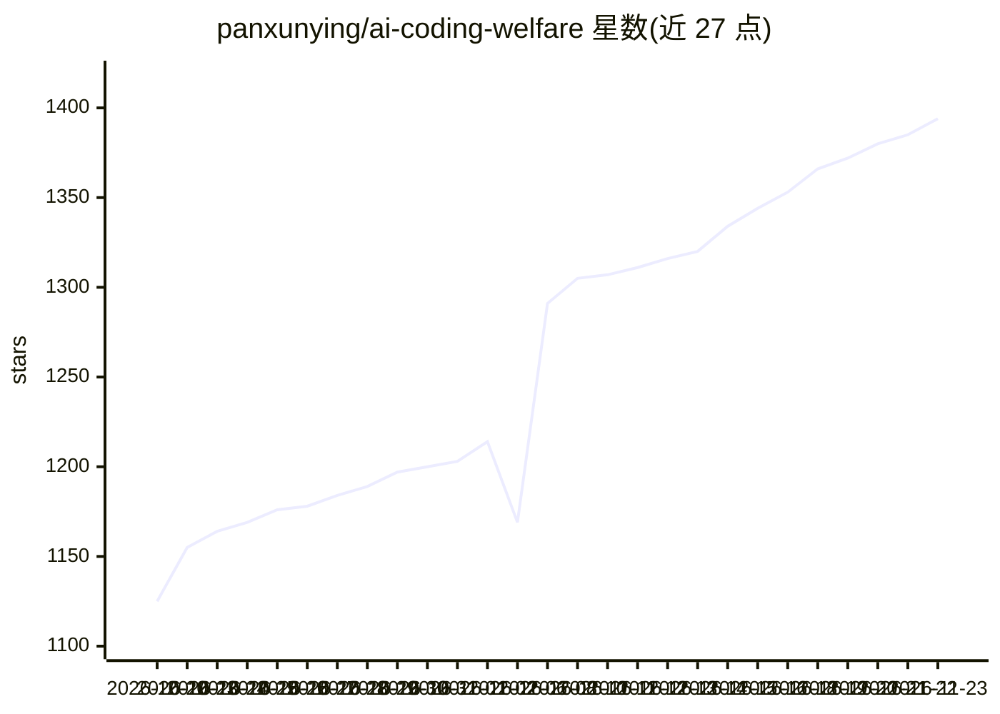

# panxunying/ai-coding-welfare

⭐ 1,394 · JavaScript · MIT · 推送 2026-11-22 · [GitHub](https://github.com/panxunying/ai-coding-welfare) · [官网](https://panxunying.github.io/ai-coding-welfare/) · 个人维护 · 中文 README

**免费使用 Claude Code / Codex 的中转公益站收录与配置导航**

收录多个提供免费额度的 Claude Code / Codex 中转站与公益站，以表格形式列出各站首日可得额度、额度构成、兼容协议与注册条件，站点状态、模型与价格由脚本抓取公开接口自动更新，并提供变动日志与 Atom 订阅。配套一键 quickstart 脚本（bash/PowerShell）写入 ANTHROPIC_BASE_URL 等环境变量，站点详情页给出 Claude Code、Codex CLI、OpenAI SDK 的接入配置示例与连通性自测命令，同时标注各站的注册限制与风险提示。

## 筛选速览

| 维度 | 判定 | 备注 |
|---|---|---|
| AI 角色 | `ai-knowledge` | 知识聚合/清单类 |
| 许可风险 | `permissive` | MIT |
| 部署形态 | `library` | 以包/库形式分发 |
| 模型依赖 | — | README 未给出锁定关系 |
| 硬件要求 | — | 无带数字的原话,不猜 |
| 安装摩擦 | `low` | 无编译、无系统依赖或容器化 |
| 成熟度 | — | 结构信号不足 |

## 能力要点

- 收录 11+ 个中转/公益站，含额度构成、邀请码与注册门槛明细
- 站点在线状态、模型与价格由脚本抓取公开接口自动更新，附变动日志与 Atom 订阅
- 提供 bash/PowerShell 一键脚本写入环境变量，覆盖 Claude Code / Codex CLI 配置示例
- 各站附使用前必读：计价倍率、证书与域名风险、封号规则等提示

## 适用场景

- 想找免费额度接入 Claude Code 或 Codex CLI 的开发者
- 对比多个中转站的额度、倍率与注册条件后选择注册
- 按站点详情页的示例快速配置环境变量与客户端

## 场景标签

`精选清单` · 领域:学习与行业

## 证据(README 行号)

> L1: AI Coding 福利站导航
> L5:  免费额度 · 白嫖 Claude Code / Codex / Cursor 的中转与公益站合集
> L54: > 「首日可得」= 注册基础额度 + 本页邀请链接额度 + 当天能领的签到额度（每日重置额度池的站点按一天的池子算）；模型、价格、在线状态由脚本抓取站点公开接口自动生成，最后更新：`2026-11-22 19:43 UTC`。

## 星数曲线

2026-10-20 1,125 → 2026-11-23 1,394（+269）

---
*卡片 v1 · prompt 1.4 · 生成 2026-11-23 · 置信度 mid · 依据 README sha `9c34ca3d6848` · [字段定义](../../DATASET.md)*
