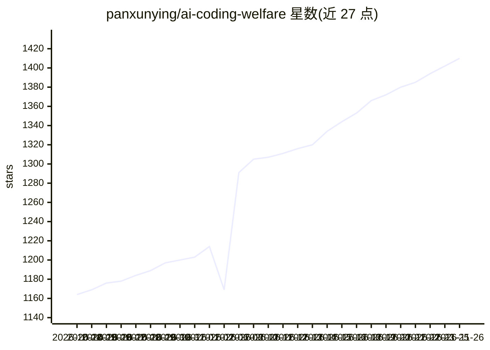

# panxunying/ai-coding-welfare

⭐ 1,410 · JavaScript · MIT · 推送 2026-11-25 · [GitHub](https://github.com/panxunying/ai-coding-welfare) · [官网](https://panxunying.github.io/ai-coding-welfare/) · 个人维护 · 中文 README

**给 AI 编程用户的免费额度中转站导航清单**

收录多个提供免费额度的 API 中转站与公益站的导航页，以表格列出各站状态、首日可得额度、额度构成、兼容协议、注册方式与邀请码；提供 git clone 后运行的一键配置脚本（bash/PowerShell）生成 Claude Code 环境变量；站点模型、价格与在线状态由脚本抓取公开接口自动更新，附可用性历史、变动日志与 Atom 订阅。每个站点条目含注册要求、接入配置示例与风险提示（如站内计价单位与美元换算、上游波动）。

## 筛选速览

| 维度 | 判定 | 备注 |
|---|---|---|
| AI 角色 | `ai-knowledge` | 知识聚合/清单类 |
| 许可风险 | `permissive` | MIT |
| 部署形态 | `library` | 以包/库形式分发 |
| 模型依赖 | — | README 未给出锁定关系 |
| 硬件要求 | — | 无带数字的原话,不猜 |
| 安装摩擦 | `low` | 无编译、无系统依赖或容器化 |
| 成熟度 | — | 结构信号不足 |

## 能力要点

- 站点额度、模型、价格、在线状态由脚本抓取公开接口自动更新
- 提供 bash/PowerShell 一键配置脚本写入 Claude Code 环境变量
- 每站附注册要求、接入配置示例与使用前风险提示
- 支持可用性历史横评、变动日志与 Atom 订阅

## 适用场景

- 查找提供免费额度的 Claude Code / Codex 可用接入站
- 按协议与额度对比选择注册哪个中转站
- 用一键脚本快速配置本地 Claude Code 环境变量

## 场景标签

`精选清单` `模型网关` · 领域:Agent 开发

## 证据(README 行号)

> L1: AI Coding 福利站导航
> L54: > 「首日可得」= 注册基础额度 + 本页邀请链接额度 + 当天能领的签到额度（每日重置额度池的站点按一天的池子算）；模型、价格、在线状态由脚本抓取站点公开接口自动生成，最后更新：`2026-11-23 23:55 UTC`。
> L69: # 交互式写好 Claude Code 的环境变量（macOS / Linux，需要 Node.js）

## 星数曲线

2026-10-24 1,164 → 2026-11-26 1,410（+246）

---
*卡片 v1 · prompt 1.4 · 生成 2026-11-24 · 置信度 mid · 依据 README sha `2e12dff4885b` · [字段定义](../../DATASET.md)*
