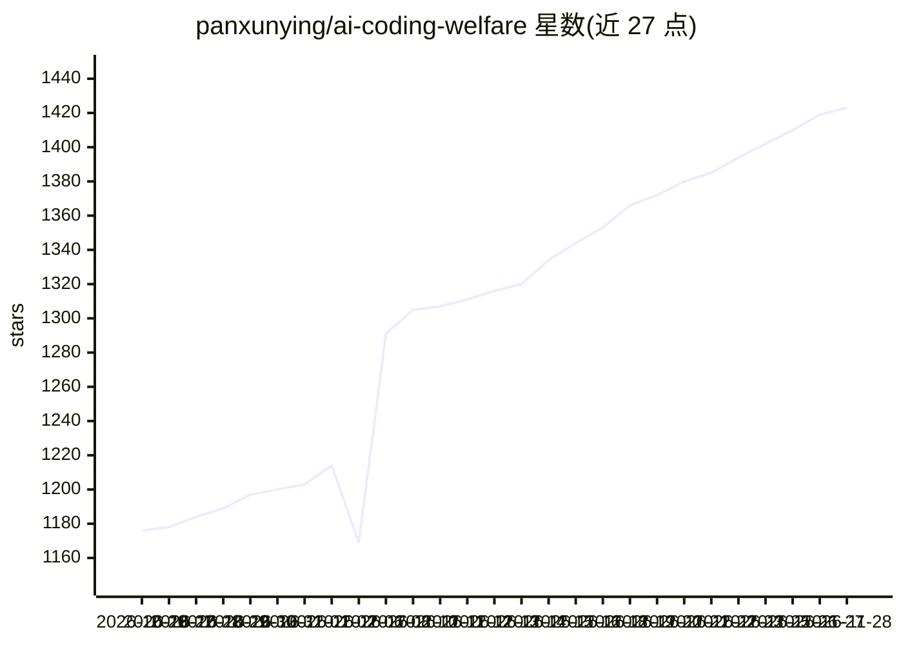

# panxunying/ai-coding-welfare

⭐ 1,423 · JavaScript · MIT · 推送 2026-11-27 · [GitHub](https://github.com/panxunying/ai-coding-welfare) · [官网](https://panxunying.github.io/ai-coding-welfare/) · 个人维护 · 中文 README

**免费 Claude Code/Codex 中转与公益站导航合集**

收录提供免费额度的 AI 编程中转站与公益站的导航清单，表格列出各站首日可得额度、额度构成、兼容协议与注册要求，站点数据由脚本抓取公开接口自动生成。提供一键配置脚本（macOS/Linux/Windows PowerShell）写入 Claude Code 环境变量，并为每个站点给出 Claude Code、Codex CLI、OpenAI SDK 的接入配置示例与风险提示（站内计价单位、倍率、域名证书问题等）。通过 Issue 区接受站点投稿。

## 筛选速览

| 维度 | 判定 | 备注 |
|---|---|---|
| AI 角色 | `ai-knowledge` | 知识聚合/清单类 |
| 许可风险 | `permissive` | MIT |
| 部署形态 | `library` | 以包/库形式分发 |
| 模型依赖 | — | README 未给出锁定关系 |
| 硬件要求 | — | 无带数字的原话,不猜 |
| 安装摩擦 | `low` | 无编译、无系统依赖或容器化 |
| 成熟度 | — | 结构信号不足 |

## 能力要点

- 收录 11 个站点，含首日可得额度、兼容协议与注册门槛对照表
- 提供 bash 与 PowerShell 一键配置脚本写入 Claude Code 环境变量
- 站点数据由脚本抓取公开接口自动更新，附变动日志与 Atom 订阅
- 每站附接入配置示例与使用前风险提示

## 适用场景

- 想免费使用 Claude Code / Codex 并寻找可用中转站
- 对比各福利站的额度、倍率与注册要求
- 按示例配置环境变量接入中转 API

## 场景标签

`精选清单` · 领域:学习与行业

## 证据(README 行号)

> L1: AI Coding 福利站导航
> L40: |站点|状态|首日可得|额度构成|之后每天|兼容协议|模型|注册|邀请码|备注|
> L54: > 「首日可得」= 注册基础额度 + 本页邀请链接额度 + 当天能领的签到额度（每日重置额度池的站点按一天的池子算）；模型、价格、在线状态由脚本抓取站点公开接口自动生成，最后更新：`2026-11-27 21:19 UTC`。

## 星数曲线

2026-10-26 1,176 → 2026-11-28 1,423（+247）

---
*卡片 v1 · prompt 1.4 · 生成 2026-11-28 · 置信度 mid · 依据 README sha `3772bf53c95f` · [字段定义](../../DATASET.md)*
