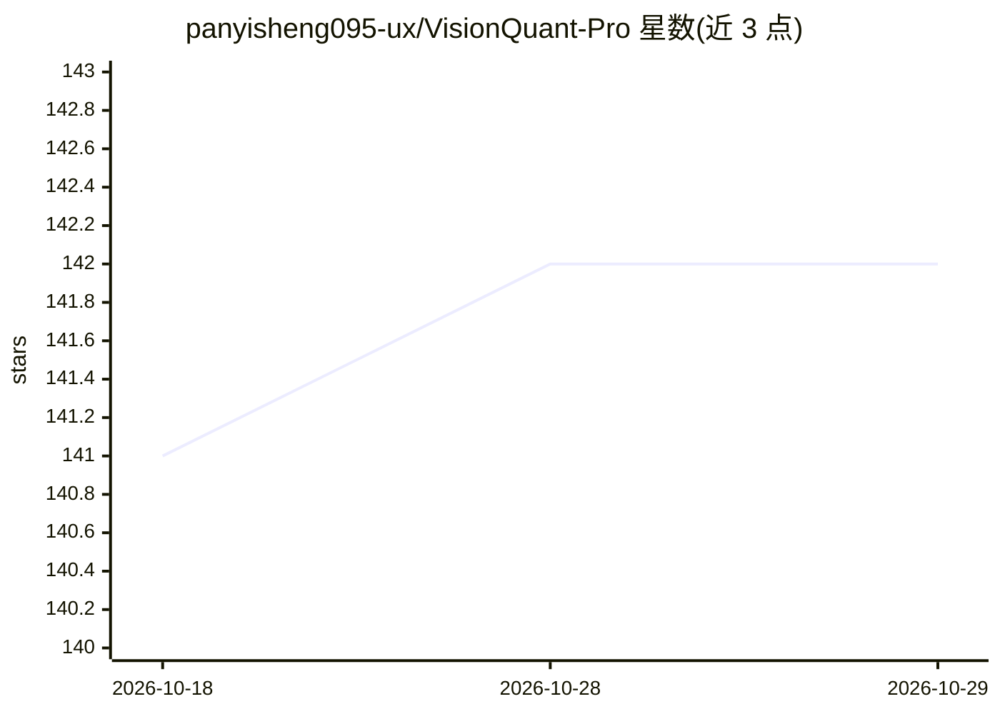

# panyisheng095-ux/VisionQuant-Pro

⭐ 142 · Python · MIT · 推送 2026-02-27 · [GitHub](https://github.com/panyisheng095-ux/VisionQuant-Pro) · 个人维护 · 中文 README

**给量化研究者：用视觉模型学习K线形态并做因子验证回测**

以K线图像视觉形态学习为核心的量化投研系统：用 AttentionCAE（CNN+多头自注意力自编码器）将K线图编码为向量，经 FAISS 粗筛与 DTW/相关性/形态特征重排，输出 Top10 历史相似形态及统计胜率作为可解释证据；将形态视为因子，用 Rolling IC、Sharpe、Regime、失效检测框架验证，配合 Triple Barrier 标签、严格无未来函数回测（含A股涨跌停/T+1约束）与 Black-Litterman/Markowitz 组合优化。数据源支持 AkShare/JQData/RQData 自动回退，提供 Streamlit 界面与 FastAPI 服务，含舆情采集与 Gemini 驱动的 QuantAgent。README 声明仅供研究学习，不构成投资建议。

## 筛选速览

| 维度 | 判定 | 备注 |
|---|---|---|
| AI 角色 | `ai-native` | 本体是模型或模型工具 |
| 许可风险 | `permissive` | MIT |
| 部署形态 | `library` | 以包/库形式分发 |
| 模型依赖 | — | README 未给出锁定关系 |
| 硬件要求 | — | 无带数字的原话,不猜 |
| 安装摩擦 | `low` | 无编译、无系统依赖或容器化 |
| 成熟度 | — | 结构信号不足 |

## 能力要点

- AttentionCAE 视觉编码 + FAISS 检索 + DTW 重排输出 Top10 历史相似形态
- 因子有效性分析框架：Rolling IC/Sharpe/Regime/失效检测（CUSUM）
- 严格无未来函数回测，含交易成本模型与A股涨跌停/T+1约束
- Black-Litterman + Markowitz 组合优化，支持 CVaR 与回撤约束

## 适用场景

- 查找与当前走势最相似的历史K线形态并查看后续统计表现
- 把视觉形态当作量化因子做 IC/Sharpe 有效性与失效检测
- 在含A股交易约束的回测体系中验证形态策略
- 通过 Streamlit 界面或 FastAPI 做投研检索与组合优化

## 场景标签

`金融量化` `语义搜索` · 领域:知识与检索

## 证据(README 行号)

> L21: **VisionQuant-Pro** 是一个以**K线视觉形态学习**为核心的量化投研系统，核心思想是：
> L46: - 传统模型告诉你“会涨”；VisionQuant-Pro告诉你“历史上最像的10个形态中，有7个上涨”。
> L149: 2. FAISS粗筛候选（`search_k`）

## 星数曲线

2026-10-18 141 → 2026-10-29 142（+1）

---
*卡片 v1 · prompt 1.4 · 生成 2026-10-22 · 置信度 mid · 依据 README sha `34ce0b755561` · [字段定义](../../DATASET.md)*
