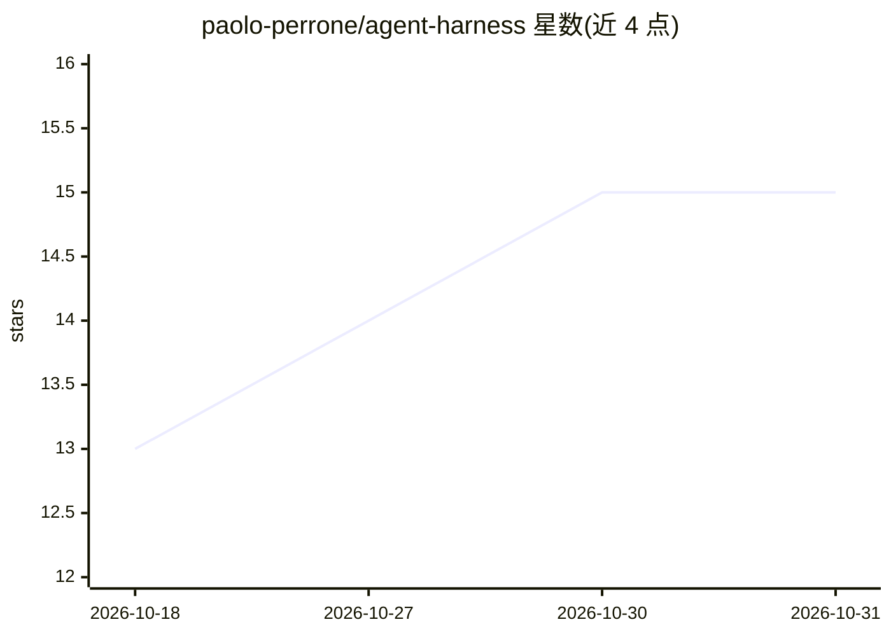

# paolo-perrone/agent-harness

⭐ 15 · Python · MIT · 推送 2026-10-27 · [GitHub](https://github.com/paolo-perrone/agent-harness) · 个人维护

**五层 agent harness 可运行示例：演示各层防护及其阻止的故障**

一篇《Agent Harness 完全指南》的配套代码库：以五个层次（执行边界、沙箱、记忆持久化、验证循环、上下文管道）分别演示开启与关闭防护时同一 agent 的行为差异。模型由脚本替身代替，所有示例无需 API key、无依赖即可用 Python 3.8+ 运行。另提供可复制到自有项目的单文件 harness.py，含 allowlist、read_only、dry_run 等组件；README 列出六类常见陷阱与自查清单。

## 筛选速览

| 维度 | 判定 | 备注 |
|---|---|---|
| AI 角色 | `ai-knowledge` | 知识聚合/清单类 |
| 许可风险 | `permissive` | MIT |
| 部署形态 | `None` |  |
| 模型依赖 | — | README 未给出锁定关系 |
| 硬件要求 | — | 无带数字的原话,不猜 |
| 安装摩擦 | `low` | 无编译、无系统依赖或容器化 |
| 成熟度 | — | 结构信号不足 |

## 能力要点

- 五层防护，每层提供 guard 开/关对照的可运行脚本
- 无 API key、无依赖，模型由确定性脚本替身代替
- test_harness.py 双向断言：故障脚本仍失败、防护脚本仍阻止
- 单文件 harness.py 可复制进自有 agent 循环，支持同步/异步

## 适用场景

- 学习 agent harness 各层防护机制并本地复现故障/防护对照
- 为自己的 agent 循环加入执行边界、路径/网络白名单等确定性防护
- 按清单审计现有 agent 设置中哪些规则由代码而非 prompt 执行

## 场景标签

`Agent 框架` · 领域:Agent 开发

## 证据(README 行号)

> L6: Companion to The Complete Guide to Agent Harnesses (With Code).
> L14: This repo ships five layers. For each one you can run the layer with its guard on,

## 星数曲线

2026-10-18 13 → 2026-10-31 15（+2）

---
*卡片 v1 · prompt 1.4 · 生成 2026-10-30 · 置信度 high · 依据 README sha `872078feb7e6` · [字段定义](../../DATASET.md)*
