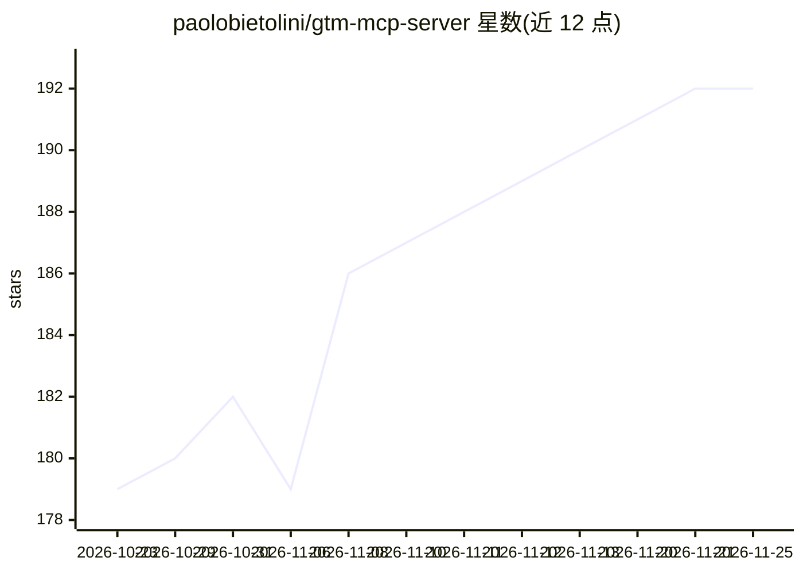

# paolobietolini/gtm-mcp-server

⭐ 192 · Go · BSD-3-Clause · 推送 2026-11-22 · [GitHub](https://github.com/paolobietolini/gtm-mcp-server) · [官网](https://mcp.gtmeditor.com) · 个人维护

**把 Google Tag Manager 接入 LLM 客户端的 MCP 服务器**

用 Go 编写的 MCP 服务器，将 MCP 客户端连接到 Google Tag Manager API，覆盖 GTM v2 106 个方法中的 101 个（排除 5 个用户权限方法），默认提供 64 个工具、全部启用时 94 个，另有 8 个资源和 6 个 prompt。支持查看容器、创建/更新工作区实体、创建版本并在显式确认后发布。提供 stdio 与 HTTP 两种传输，认证支持浏览器 OAuth、Google 服务账号或两者混合。托管端点已关闭，仅可自托管。

## 筛选速览

| 维度 | 判定 | 备注 |
|---|---|---|
| AI 角色 | `ai-ecosystem` | LLM/agent 周边工具 |
| 许可风险 | `permissive` | BSD-3-Clause |
| 部署形态 | `desktop` | 安装包/桌面程序 |
| 模型依赖 | — | README 未给出锁定关系 |
| 硬件要求 | — | 无带数字的原话,不猜 |
| 安装摩擦 | `low` | 无编译、无系统依赖或容器化 |
| 成熟度 | — | 结构信号不足 |

## 能力要点

- 实现 GTM v2 API 106 个方法中的 101 个，默认暴露 64 个工具（GTM_TOOL_GROUPS=all 时 94 个）
- 支持 stdio（本地服务账号）与 MCP Streamable HTTP（多用户 OAuth）两种部署模式
- 每个 OAuth 用户以自己的 Google 身份和 GTM 权限操作
- 发布版本需显式确认；用户权限类方法被有意排除

## 适用场景

- 通过 Claude Code、Cursor 等客户端用自然语言管理 GTM 容器与工作区
- 团队共享一个自托管端点，各成员保留各自 GTM 权限
- 用服务账号模式在 CI 或自动化 agent 中操作 GTM

## 场景标签

 · 领域:LLM 基础设施/MCP 工具服务

## 证据(README 行号)

> L18: GTM MCP Server connects MCP clients to the Google Tag Manager API. It can
> L33: |Transport|MCP Streamable HTTP, or stdio for local service-account use|

## 星数曲线

2026-10-23 179 → 2026-11-25 192（+13）

---
*卡片 v1 · prompt 1.4 · 生成 2026-11-25 · 置信度 high · 依据 README sha `2b6dc8f18782` · [字段定义](../../DATASET.md)*
