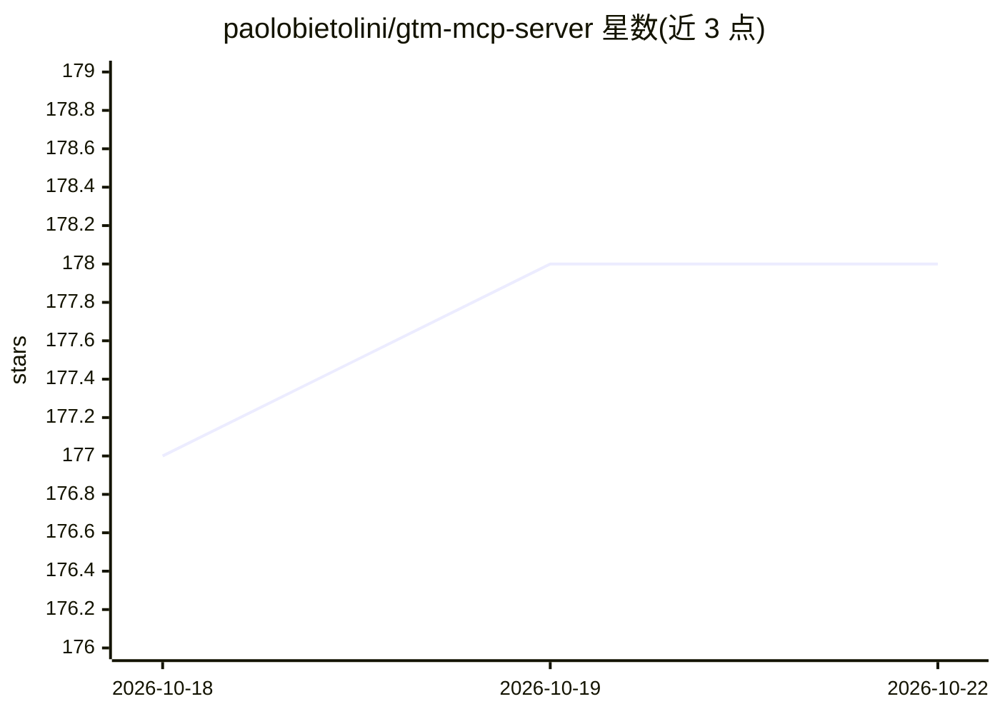

# paolobietolini/gtm-mcp-server

⭐ 179 · Go · BSD-3-Clause · 推送 2026-10-20 · [GitHub](https://github.com/paolobietolini/gtm-mcp-server) · [官网](https://mcp.gtmeditor.com) · 个人维护

**让 LLM 通过 MCP 管理 Google Tag Manager 的服务器**

基于 Go 的 MCP 服务器，将 MCP 客户端（Claude Code、Gemini CLI、Cursor、ChatGPT 等）接入 Google Tag Manager API：支持浏览器 OAuth 与服务账户两种认证，默认提供 64 个 GTM 工具（全部开启 94 个加 2 个工具类），覆盖官方 106 个方法中的 101 个。功能包括检查容器、创建/更新标签、触发器、变量、模板、版本与发布（发布需显式 confirm）。删除、发布等危险操作要求 confirm:true；账户权限管理方法被有意排除。提供托管端点（2026-11-30 关停）与自托管路径。

## 筛选速览

| 维度 | 判定 | 备注 |
|---|---|---|
| AI 角色 | `ai-ecosystem` | LLM/agent 周边工具 |
| 许可风险 | `permissive` | BSD-3-Clause |
| 部署形态 | `desktop` | 安装包/桌面程序 |
| 模型依赖 | — | README 未给出锁定关系 |
| 硬件要求 | — | 无带数字的原话,不猜 |
| 安装摩擦 | `low` | 无编译、无系统依赖或容器化 |
| 成熟度 | — | 结构信号不足 |

## 能力要点

- 101/106 官方 GTM v2 API 方法覆盖，账户权限方法被有意排除
- 64 个默认工具 / 94 个全量工具 + 8 资源 + 6 prompts
- 删除、发布等操作要求 confirm:true 的安全模型
- 支持浏览器 OAuth 与服务账户认证

## 适用场景

- 通过自然语言让 LLM 审计 GTM 工作区（重复标签、未用触发器）
- 对话式创建 GA4 事件标签、触发器与变量并管理版本发布
- 从 Community Template Gallery 导入模板、生成 Markdown 跟踪计划

## 场景标签

 · 领域:开发者工具/营销技术

## 证据(README 行号)

> L12: GTM MCP Server connects MCP clients to the Google Tag Manager API. It can
> L41: Add the hosted URL as a remote HTTP MCP server. The client should discover the OAuth metadata, open Google sign-in,
> L47: claude mcp add --transport http gtm https://mcp.gtmeditor.com

## 星数曲线

2026-10-18 177 → 2026-10-22 178（+1）

---
*卡片 v1 · prompt 1.4 · 生成 2026-10-22 · 置信度 high · 依据 README sha `d58eb3d005a7` · [字段定义](../../DATASET.md)*
