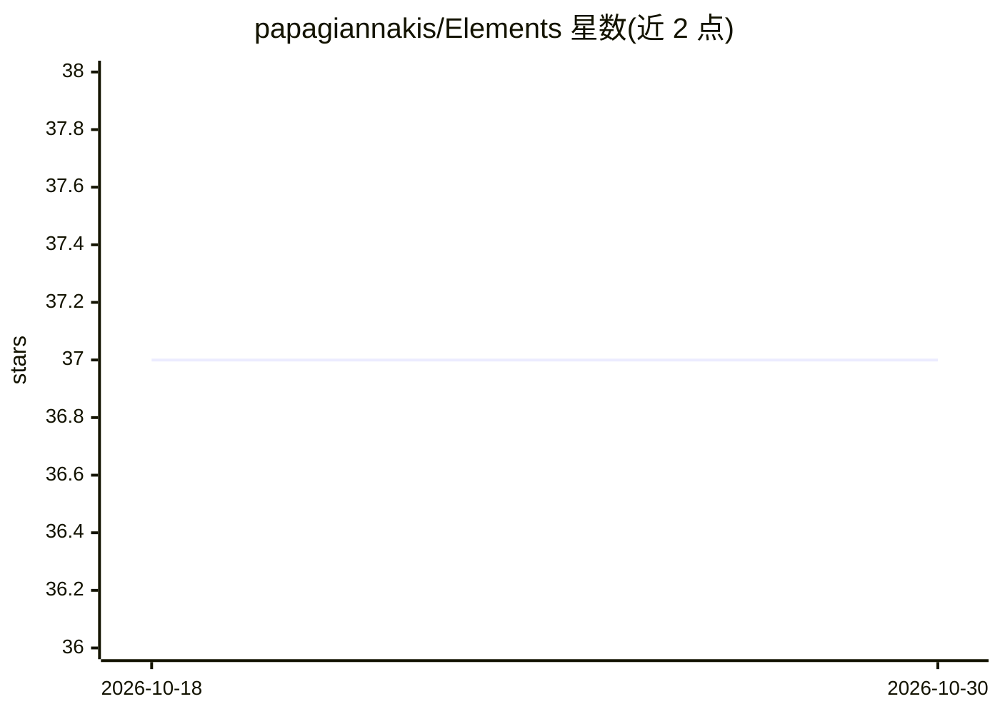

# papagiannakis/Elements

⭐ 37 · Jupyter Notebook · Apache-2.0 · 推送 2026-10-27 · [GitHub](https://github.com/papagiannakis/Elements) · [官网](https://papagiannakis.github.io/Elements/) · 组织维护

**面向计算机图形学与深度学习教学的 Python 实体组件系统框架**

Project Elements 将 Entity-Component-System（ECS）架构与场景图结合，用于计算机图形学、科学可视化与深度学习相关的教学与开发。包含三个包：pyECSS（在任意场景图上应用 ECS）、pyGLV（将 ECSS 用于 CG、DL 与 SciViz 问题）、pyEEL（学习中心）。全部采用 Python 实现，配套示例、文档与 Eurographics 2023 教育论文。安装需克隆仓库、用 conda 创建 Python 3.9 环境并以 pip 可编辑模式安装；可选组件 imgui_bundle 在 macOS 上存在源码构建失败问题。

## 筛选速览

| 维度 | 判定 | 备注 |
|---|---|---|
| AI 角色 | `ai-enhanced` | 去掉 AI 部分产品仍成立 |
| 许可风险 | `permissive` | Apache-2.0 |
| 部署形态 | `library` | 以包/库形式分发 |
| 模型依赖 | — | README 未给出锁定关系 |
| 硬件要求 | — | 无带数字的原话,不猜 |
| 安装摩擦 | `medium` | 含编译或系统依赖之一 |
| 成熟度 | — | 结构信号不足 |

## 能力要点

- ECS 架构与场景图结合的 Python 框架
- 三个子包：pyECSS、pyGLV、pyEEL 分工明确
- 配套示例与教程（Elements/examples）
- 配套 Eurographics 2023 教育论文与引用条目

## 适用场景

- 学习计算机图形学与几何深度学习的课程内容
- 在场景图上应用 ECS 模式构建图形/可视化程序
- 作为几何代数、科学可视化等主题的教学与研究起点

## 场景标签

`教程课程` · 领域:学习与行业

## 证据(README 行号)

> L11: Elements introduces for the first time the power of the Entity-Component-System (ECS) with the versatility of Scene
> L20: * pyGLV : A package applying ECSS to CG, DL and SciViz problems

## 星数曲线

2026-10-18 37 → 2026-10-30 37（+0）

---
*卡片 v1 · prompt 1.4 · 生成 2026-10-25 · 置信度 mid · 依据 README sha `5db8363cded8` · [字段定义](../../DATASET.md)*
