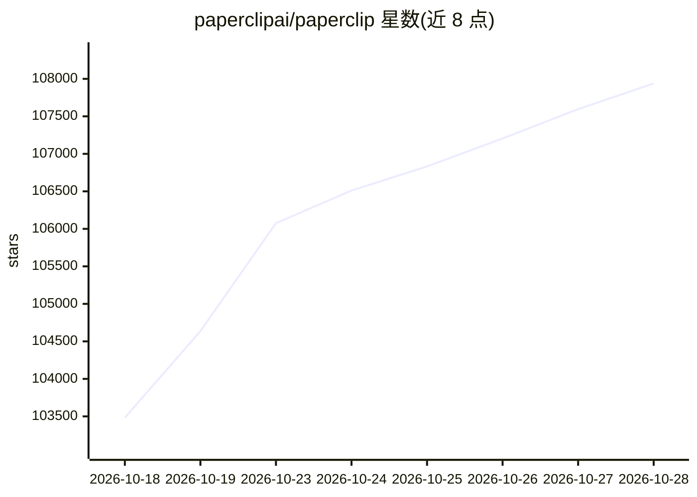

# paperclipai/paperclip

⭐ 107,938 · TypeScript · MIT · 推送 2026-10-27 · [GitHub](https://github.com/paperclipai/paperclip) · [官网](https://paperclip.ing) · 组织维护

**开源的团队级 AI agent 编排与治理平台**

Node.js 服务端 + React UI 的控制平面，用于组织和管理多个 AI agent 团队：接入自带 agent（OpenClaw、Claude Code、Codex、Cursor、Gemini CLI 等），分配任务与目标，通过心跳队列驱动执行，并提供任务线程、组织架构与权限、审批与治理门禁、成本与预算控制、定时例程、技能工作室及多组织隔离等能力。面向希望让多个 agent 长期自主运行并同时保留审计与人工介入的团队。

## 筛选速览

| 维度 | 判定 | 备注 |
|---|---|---|
| AI 角色 | `ai-ecosystem` | LLM/agent 周边工具 |
| 许可风险 | `permissive` | MIT |
| 部署形态 | `library` | 以包/库形式分发 |
| 模型依赖 | — | README 未给出锁定关系 |
| 硬件要求 | — | 无带数字的原话,不猜 |
| 安装摩擦 | `low` | 无编译、无系统依赖或容器化 |
| 成熟度 | `idea` | |

## 动量与使用信号

- 维护:`active` — 距上次 push 0.7 天,年发版 29,217 位贡献者
- 涨星:近 1 天 **+610**(自 20261016 起算)
- 安装:npm 包 `paperclipai@latest` 月下载无数据
- 平台:— · 协议:MCP

## 能力要点

- 跨运行时接入任意可接收心跳的 agent，统一组织架构管理
- 心跳执行队列：任务唤醒、预算检查、密钥注入、技能加载与受限恢复
- 公司/agent/项目多级预算、阈值告警与硬停机制
- 审批门禁、配置版本化回滚与组织边界隔离

## 适用场景

- 把多个编码或业务 agent 编成团队，围绕一个业务目标分工协作
- 追踪 20 个并发 agent 终端的工作状态与开销
- 为周期性任务（客服、报告等）设置定时例程并自动派发给 agent
- 对 agent 的操作设置审批与权限边界，保留完整审计记录

## 场景标签

`多智能体` `Agent 框架` · 领域:Agent 开发

## 证据(README 行号)

> L27: Paperclip is a Node.js server and React UI that orchestrates a team of AI agents to run a business. Bring your own 
> L54: Custom processes, HTTP endpoints, and external adapter packages extend the roster. See the adapter overview for set
> L156: Paperclip is a full control plane, not a wrapper. Before you build any of this yourself, know that it already exis

## 星数曲线

2026-10-18 103,483 → 2026-10-28 107,938（+4,455）

---
*卡片 v1 · prompt 1.4 · 生成 2026-10-20 · 置信度 high · 依据 README sha `ad138a24fb9e` · [字段定义](../../DATASET.md)*
