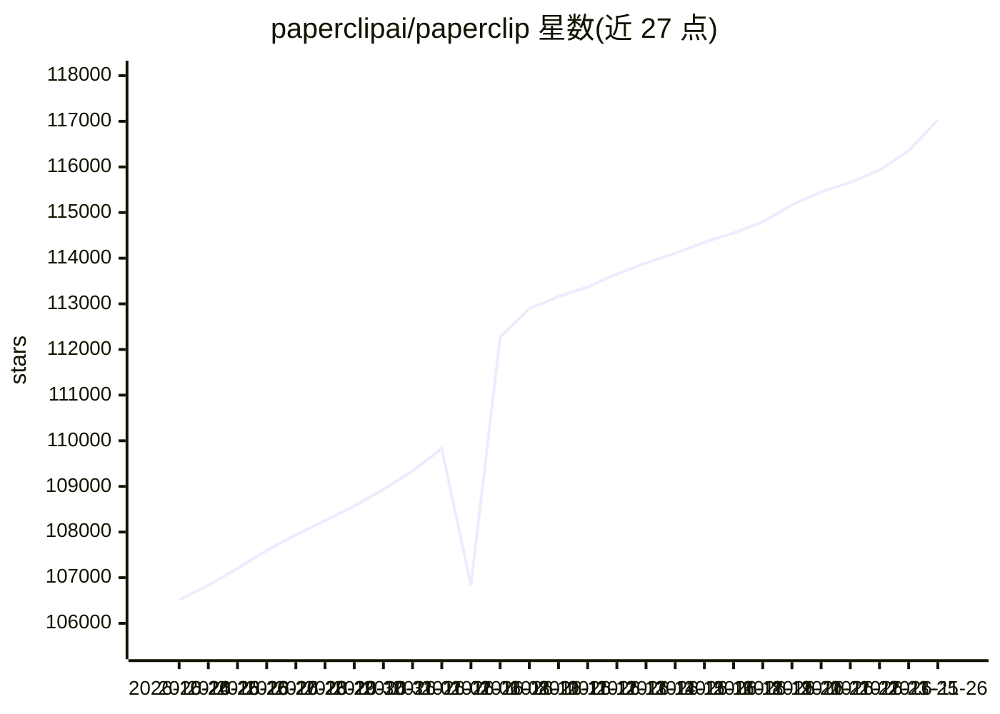

# paperclipai/paperclip

⭐ 117,029 · TypeScript · MIT · 推送 2026-11-25 · [GitHub](https://github.com/paperclipai/paperclip) · [官网](https://paperclip.ing) · 组织维护

**给团队编排管理 AI agent 的开源控制台**

Node.js 服务端加 React UI 的 AI agent 编排应用：用户自定义业务目标、组建 agent 组织架构，从统一面板跟踪任务、审批与成本。机制上提供心跳唤醒调度、原子任务认领锁、预算硬停、审批门与角色权限，通过适配器接入 Claude Code、Codex、Cursor 等多种 harness，支持多组织隔离与定时例程。以 MIT 协议开源，另提供 Paperclip Cloud 候补名单。

## 筛选速览

| 维度 | 判定 | 备注 |
|---|---|---|
| AI 角色 | `ai-ecosystem` | LLM/agent 周边工具 |
| 许可风险 | `permissive` | MIT |
| 部署形态 | `library` | 以包/库形式分发 |
| 模型依赖 | — | README 未给出锁定关系 |
| 硬件要求 | — | 无带数字的原话,不猜 |
| 安装摩擦 | `low` | 无编译、无系统依赖或容器化 |
| 成熟度 | — | 结构信号不足 |

## 动量与使用信号

- 维护:`active` — 距上次 push 0.7 天,年发版 29,217 位贡献者
- 涨星:近 1 天 **+610**(自 20261016 起算)
- 安装:npm 包 `paperclipai@latest` 月下载无数据
- 平台:— · 协议:MCP

## 能力要点

- 心跳调度与 DB 支持的唤醒队列，agent 按任务/消息/日程唤醒
- 原子任务认领与执行锁，防止多个 run 争抢同一任务
- 按公司/agent/项目/模型的成本追踪与预算硬停
- 组织架构、权限、审批门与可回滚的配置版本管理

## 适用场景

- 协调多个编码 agent（Claude Code/Codex/Cursor）朝同一业务目标工作
- 让 agent 24/7 自主运行并保留审计与随时介入能力
- 为 agent 团队设置预算上限并监控 token 花费
- 把定时任务（客服、报告）交给 agent 例程自动执行

## 场景标签

`多智能体` `Agent 框架` · 领域:Agent 开发

## 证据(README 行号)

> L23: Open-source orchestration for teams of AI agents.
> L27: Paperclip is a Node.js server and React UI that orchestrates a team of AI agents to run a business. Bring your own 
> L169: **Org Chart & Agents** — Agents have roles, titles, reporting lines, permissions, and budgets. Adapter examples ma

## 星数曲线

2026-10-24 106,511 → 2026-11-26 117,029（+10,518）

---
*卡片 v1 · prompt 1.4 · 生成 2026-11-22 · 置信度 high · 依据 README sha `0c5223da14dd` · [字段定义](../../DATASET.md)*
