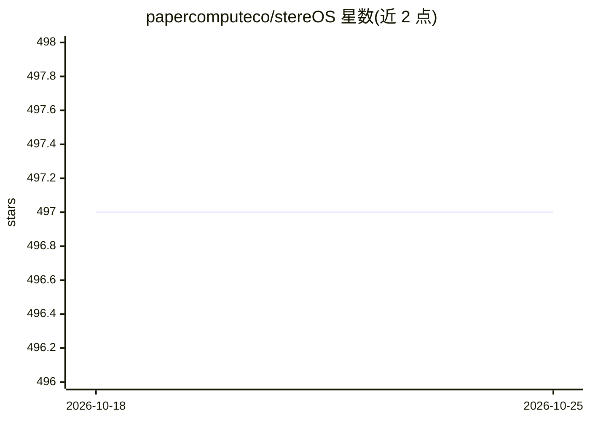

# papercomputeco/stereOS

⭐ 498 · Nix · NOASSERTION · 推送 2026-09-24 · [GitHub](https://github.com/papercomputeco/stereOS) · [官网](https://stereos.ai) · 组织维护

**为 AI agent 定制加固的 Linux 操作系统（NixOS 构建）**

基于 NixOS 的 Linux 发行版，面向 AI agent 运行环境构建与加固。以机器镜像（mixtapes）形式发布，将精简加固的系统与特定 agent harness（如 opencode，需 ANTHROPIC_API_KEY 或 OPENAI_API_KEY）打包。系统采用最小化设计，通过 stereosd 与 agentd 两个守护进程处理 agent 生命周期并充当控制平面，划分 admin/agent 两个用户与受限 PATH。镜像支持 Raw EFI、QCOW2、内核直启及 AWS Lambda MicroVM 源等多种格式，并用 mkDist 组装带校验和的发布目录。

## 筛选速览

| 维度 | 判定 | 备注 |
|---|---|---|
| AI 角色 | `ai-ecosystem` | LLM/agent 周边工具 |
| 许可风险 | `none` | NOASSERTION |
| 部署形态 | `self-host` | docker 或自建部署 |
| 模型依赖 | — | README 未给出锁定关系 |
| 硬件要求 | — | 无带数字的原话,不猜 |
| 安装摩擦 | `low` | 无编译、无系统依赖或容器化 |
| 成熟度 | — | 结构信号不足 |

## 能力要点

- mixtape 机器镜像：加固 Linux + 特定 agent harness 打包
- stereosd/agentd 双守护进程管理 agent 生命周期与控制平面
- agent 用户受限 PATH，通过 NixOS 选项声明式配置
- Raw EFI/QCOW2/内核直启/AWS Lambda MicroVM 多种镜像格式与 mkDist 发布流程

## 适用场景

- 为 AI agent 提供加固、最小化的隔离运行系统
- 运维人员以控制平面方式管理 agent 生命周期
- 将 agent 系统打包为 QEMU/KVM 或 AWS Lambda MicroVM 镜像部署

## 场景标签

`Agent 框架` · 领域:Agent 开发

## 证据(README 行号)

> L3:  A Linux based operating system hardened and purpose-built for AI agents.
> L15: stereOS produces machine images - called **mixtapes** - that bundle a
> L16: hardened, minimal Linux system with specific AI agent harnesses.
> L28: The stereOS system is minimal in nature with several orchestration daemons
> L29: handling agent lifecycle and acting as a control plane for agent operators:

## 星数曲线

2026-10-18 497 → 2026-10-25 497（+0）

---
*卡片 v1 · prompt 1.4 · 生成 2026-10-21 · 置信度 mid · 依据 README sha `f38285e3dd0e` · [字段定义](../../DATASET.md)*
