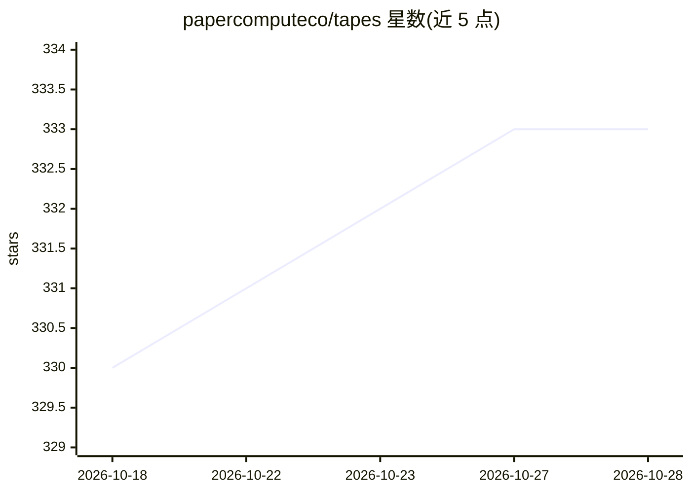

# papercomputeco/tapes

⭐ 333 · Go · Apache-2.0 · 推送 2026-10-24 · [GitHub](https://github.com/papercomputeco/tapes) · [官网](https://tapes.dev) · 组织维护

**面向开发者的 agent 遥测系统：持久化采集 LLM 会话并派生会话/追踪/ spans**

tapes 是一个 Agentic 遥测系统，面向需要留存和查询 agent 工作记录的开发者。它以 append-only 的 raw_turns 日志持久化截获的 LLM 交互，由幂等的 deriver 投影为 sessions→traces→spans 读模型（派生 ID 确定性可复现），通过 REST API 提供会话列表、span 级统计与语义搜索，并保留原始交互逐字可查。tapesctl 客户端以即时捕获代理方式启动 claude/codex/pi 等 agent 并回传。会话存储依赖 PostgreSQL，Docker bootstrap 可一键拉起本地 Postgres 与 Ollama。采用双许可。

## 筛选速览

| 维度 | 判定 | 备注 |
|---|---|---|
| AI 角色 | `ai-ecosystem` | LLM/agent 周边工具 |
| 许可风险 | `permissive` | Apache-2.0 |
| 部署形态 | `None` |  |
| 模型依赖 | local-ok | 支持本地模型 |
| 硬件要求 | — | 无带数字的原话,不猜 |
| 安装摩擦 | `low` | 无编译、无系统依赖或容器化 |
| 成熟度 | — | 结构信号不足 |

## 能力要点

- append-only raw_turns 日志与幂等 deriver 投影为 sessions/traces/spans，派生 ID 确定性
- REST API 提供会话分页、span 级统计（/v1/stats）与 span 语义搜索
- tapesctl 通过即时捕获代理启动 claude/codex/pi 并采集其 LLM 交互
- 内置 Merkle 内容寻址用于溯源与去重

## 适用场景

- 留存并事后查询 agent 会话的完整追踪与 span 明细
- 导出 agent 会话为 JSONL 做分析或归档
- 接入自己的 agent，通过代理自动采集每次 LLM 交互

## 场景标签

`LLM 可观测性` · 领域:评测与运维

## 证据(README 行号)

> L18: `tapes` is an Agentic telemetry system for content-addressable LLM interactions.
> L19: It provides durable storage of agent sessions, plug-and-play OpenTelemetry instrumentation,
> L20: and a derived sessions/traces/spans model for querying and exporting past agent work.

## 星数曲线

2026-10-18 330 → 2026-10-28 333（+3）

---
*卡片 v1 · prompt 1.4 · 生成 2026-10-21 · 置信度 high · 依据 README sha `29803eff884b` · [字段定义](../../DATASET.md)*
