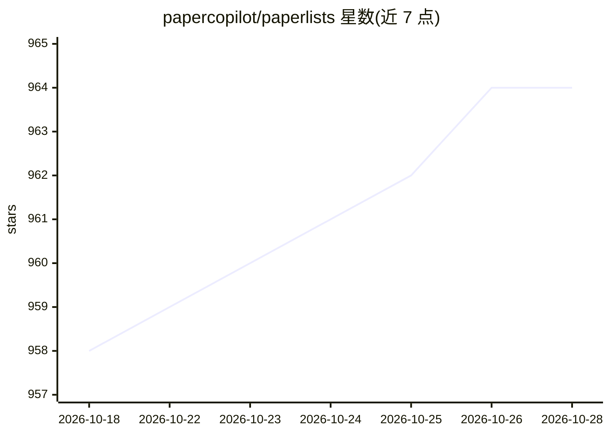

# papercopilot/paperlists

⭐ 963 · Python · 推送 2026-07-01 · [GitHub](https://github.com/papercopilot/paperlists) · [官网](https://papercopilot.com/) · 组织维护

**学术会议论文数据集：聚合多源论文记录供检索与统计**

为 Paper Copilot 提供数据支撑的仓库：整合 OpenReview、会议官网与开放获取站点的论文记录，覆盖 ICLR、NeurIPS、ICML、SIGGRAPH、CVPR、EMNLP、CoRL 等会议的多年 JSON 数据与统计页面。另提供基于 Streamlit 的本地检索工具，支持 Web 界面与命令行两种方式按关键词和字段搜索 JSON 记录。数据覆盖年份各会议不一，ICCV 与 ECCV 标注 Coming Soon。

## 筛选速览

| 维度 | 判定 | 备注 |
|---|---|---|
| AI 角色 | `ai-knowledge` | 知识聚合/清单类 |
| 许可风险 | `none` | — |
| 部署形态 | `library` | 以包/库形式分发 |
| 模型依赖 | — | README 未给出锁定关系 |
| 硬件要求 | — | 无带数字的原话,不猜 |
| 安装摩擦 | `low` | 无编译、无系统依赖或容器化 |
| 成熟度 | — | 结构信号不足 |

## 能力要点

- 整合 OpenReview 等多源论文记录为统一 JSON 数据
- 覆盖 ICLR/NeurIPS/ICML/SIGGRAPH/CVPR/EMNLP/CoRL 等会议
- Streamlit 本地检索工具（Web 界面 + 命令行）
- 支持按关键词与 title/keywords 等字段过滤

## 适用场景

- 本地检索某会议某年的论文记录
- 做论文录用统计分析
- 为 Paper Copilot 类应用提供数据源

## 场景标签

`科研工具` · 领域:学习与行业

## 证据(README 行号)

> L3: This repository powers Paper Copilot, combining data from multiple sources to ensure coherence, consistency, and com
> L5: Typically, records from OpenReview, official conference sources, or open access sites are scattered, leading to frag

## 星数曲线

2026-10-18 958 → 2026-10-28 964（+6）

---
*卡片 v1 · prompt 1.4 · 生成 2026-10-21 · 置信度 high · 依据 README sha `a338c8907e73` · [字段定义](../../DATASET.md)*
