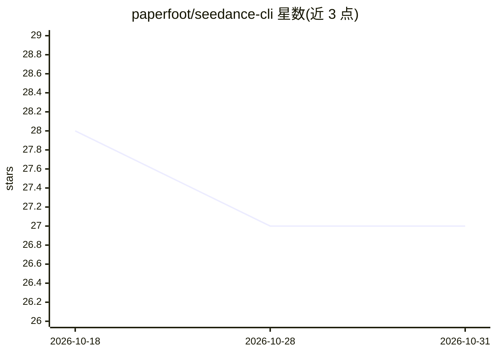

# paperfoot/seedance-cli

⭐ 27 · Rust · MIT · 推送 2026-08-08 · [GitHub](https://github.com/paperfoot/seedance-cli) · [官网](https://crates.io/crates/seedance) · 个人维护 · 中文 README

**终端调用 ByteDance Seedance 生成 AI 视频的 Rust CLI**

以单一 Rust 静态二进制封装 BytePlus ModelArk 上的 Seedance 2.0/2.5 视频生成 API：支持文生视频、图生视频、首尾帧、音视频参考（2.5 支持纯音频驱动），分辨率至 4K，时长 4–30 秒。输出 JSON/TTY 双模式、语义退出码、sidecar 清单文件，便于脚本与 agent 驱动。附 character-sheet、audio-to-video、prep-face、upload 四个辅助工具应对 API 限制（真实人脸过滤、音频后处理变形、视频仅接受 URL 等）。需 BytePlus API key，付费按秒计费。

## 筛选速览

| 维度 | 判定 | 备注 |
|---|---|---|
| AI 角色 | `ai-native` | 本体是模型或模型工具 |
| 许可风险 | `permissive` | MIT |
| 部署形态 | `library` | 以包/库形式分发 |
| 模型依赖 | — | README 未给出锁定关系 |
| 硬件要求 | — | 无带数字的原话,不猜 |
| 安装摩擦 | `medium` | 含编译或系统依赖之一 |
| 成熟度 | `idea` | |

## 能力要点

- 文/图/音/视频参考混合输入，支持 480p–4K、4–30 秒
- JSON 管道输出、语义退出码与 agent-info 能力清单，面向 agent 驱动
- character-sheet / audio-to-video / prep-face / upload 四个辅助工具绕开 API 限制
- cargo install 单二进制安装，MIT 许可

## 适用场景

- 在终端或脚本中调用 Seedance 生成 AI 视频
- 让编程 agent 通过 CLI 驱动视频生成流程
- 多镜头、多参考的角色一致性短视频制作

## 场景标签

`视频生成` · 领域:内容生成

## 证据(README 行号)

> L3: **Generate AI video with text, images, and reference footage. One Rust binary. No MCP server required.**
> L17: Pay-per-second video generation from ByteDance, wrapped in a tool agents can actually drive. JSON on pipe, human-re
> L61: seedance generate --prompt "A cat yawns at the camera" --wait

## 星数曲线

2026-10-18 28 → 2026-10-31 27（-1）

---
*卡片 v1 · prompt 1.4 · 生成 2026-10-26 · 置信度 high · 依据 README sha `3b50ca0aee86` · [字段定义](../../DATASET.md)*
