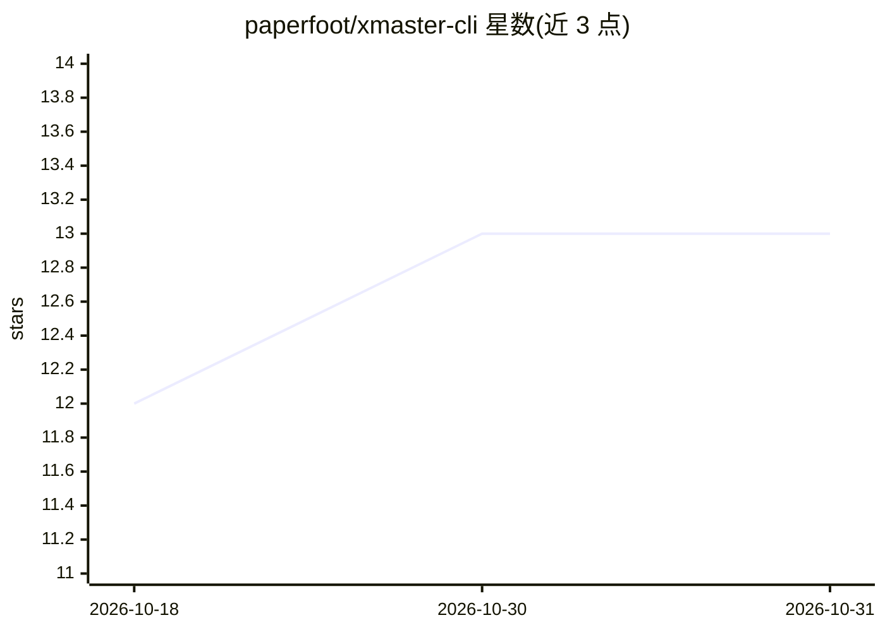

# paperfoot/xmaster-cli

⭐ 13 · Rust · MIT · 推送 2026-10-26 · [GitHub](https://github.com/paperfoot/xmaster-cli) · 个人维护

**让 AI agent 通过浏览器会话读写 X 的 Rust CLI 工具**

单个 Rust 二进制的 X (Twitter) 命令行工具：通过用户已登录的浏览器会话执行读帖、回复、发帖、点赞、关注等操作，日常命令不走付费 API；无会话时回退到 X API v2、FxTwitter、xAI 等路由。面向运行 Claude Code / Codex / Gemini 的用户与需要 JSON 输出的开发者：提供约 7KB 的 agent-info 清单、统一 JSON 错误格式（含 retryable/retry_after_secs）、分级退出码、只读与命令白名单环境变量，以及可选 JEV key 驱动的回复目标挑选与草稿检查。安装支持 Homebrew、cargo 与安装脚本。

## 筛选速览

| 维度 | 判定 | 备注 |
|---|---|---|
| AI 角色 | `ai-ecosystem` | LLM/agent 周边工具 |
| 许可风险 | `permissive` | MIT |
| 部署形态 | `library` | 以包/库形式分发 |
| 模型依赖 | — | README 未给出锁定关系 |
| 硬件要求 | — | 无带数字的原话,不猜 |
| 安装摩擦 | `medium` | 含编译或系统依赖之一 |
| 成熟度 | — | 结构信号不足 |

## 能力要点

- 经浏览器会话读帖/回复/发帖/点赞/关注，日常命令无 API 费用
- agent 适配：JSON 输出、agent-info 清单、统一错误格式与 5 级退出码
- XMASTER_READ_ONLY 与命令白名单/黑名单环境变量做无人值守防护
- xmaster skill install 为 Claude Code、Codex、Gemini CLI 安装技能

## 适用场景

- 让 Claude Code / Codex / Gemini 等 agent 代管 X 账号的读写操作
- 在 shell 中以 JSON 输出批量读取 X 帖子、会话与搜索结果
- 用 --dry-run 与草稿检查在发送前预检回复内容

## 场景标签

`浏览器自动化` `网页抓取` · 领域:效率与自动化

## 证据(README 行号)

> L15: For people who run Claude Code, Codex or Gemini on their X account, and for developers who want X in the shell with
> L42: - **Made for agents.** Compact JSON when piped, one error format with `retryable` and `retry_after_secs`, exit code
> L99: xmaster skill install        # installs the skill for Claude Code, Codex, Gemini CLI and ~/.agents

## 星数曲线

2026-10-18 12 → 2026-10-31 13（+1）

---
*卡片 v1 · prompt 1.4 · 生成 2026-10-31 · 置信度 high · 依据 README sha `65d3f7521fc8` · [字段定义](../../DATASET.md)*
