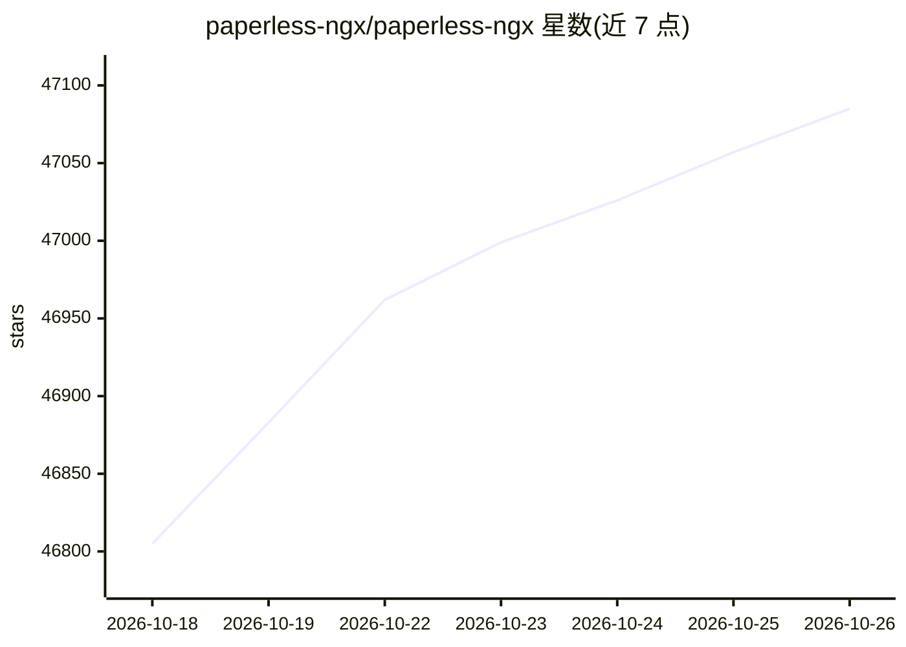

# paperless-ngx/paperless-ngx

⭐ 47,085 · Python · GPL-3.0 · 推送 2026-10-25 · [GitHub](https://github.com/paperless-ngx/paperless-ngx) · [官网](http://docs.paperless-ngx.com/) · 组织维护

**将纸质文档扫描、索引并归档为可搜索在线档案的文档管理系统**

社区维护的文档管理系统，把实体文档转化为可搜索的在线归档，主题标签涉及 OCR、机器学习、PDF 等能力方向。项目是 Paperless 与 Paperless-ng 的官方继任者，由团队分工推进，提供多语言翻译协作、GitHub Discussions 收集功能请求，并有在线 demo。README 提醒文档可能包含敏感信息，数据明文存储，建议在本地可信服务器上运行并做好备份。

## 筛选速览

| 维度 | 判定 | 备注 |
|---|---|---|
| AI 角色 | `ai-ecosystem` | LLM/agent 周边工具 |
| 许可风险 | `viral` | GPL-3.0 |
| 部署形态 | `self-host` | docker 或自建部署 |
| 模型依赖 | — | README 未给出锁定关系 |
| 硬件要求 | — | 无带数字的原话,不猜 |
| 安装摩擦 | `low` | 无编译、无系统依赖或容器化 |
| 成熟度 | — | 结构信号不足 |

## 动量与使用信号

- 维护:`active` — 距上次 push 0.8 天,年发版 40,400 位贡献者
- 涨星:近 1 天 **+66**(自 20261016 起算)

## 能力要点

- 将实体文档转化为可搜索在线归档
- 提供 docker compose 部署路径与安装脚本
- 支持多语言翻译协作与社区团队分工
- 提供官方在线 demo（demo.paperless-ngx.com）

## 适用场景

- 把家庭或办公室的纸质文件扫描归档成可检索的在线档案
- 发票、税单等敏感文档的本地私有化管理
- 从 Paperless-ng 迁移到维护更活跃的版本

## 场景标签

`OCR` · 领域:感知与多模态

## 证据(README 行号)

> L10: Paperless-ngx is a document management system that transforms your physical documents into a searchable online arch
> L29: The easiest way to deploy paperless is `docker compose`. The files in the `/docker/compose` directory are configure
> L12: Paperless-ngx is the official successor to the original Paperless & Paperless-ng projects and is designed to distri

## 星数曲线

2026-10-18 46,805 → 2026-10-26 47,085（+280）

---
*卡片 v1 · prompt 1.4 · 生成 2026-10-18 · 置信度 high · 依据 README sha `63e91fb10706` · [字段定义](../../DATASET.md)*
