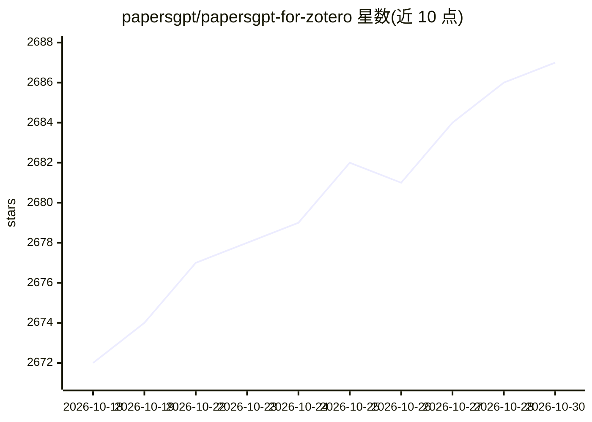

# papersgpt/papersgpt-for-zotero

⭐ 2,687 · JavaScript · AGPL-3.0 · 推送 2026-10-22 · [GitHub](https://github.com/papersgpt/papersgpt-for-zotero) · [官网](https://www.papersgpt.com) · 组织维护

**Zotero 的本地 AI 多文档问答插件，支持 MCP**

以 Native C++ 实现的 Zotero 扩展，将本地 PDF 库建立为结构化索引，提供单 PDF、多 PDF 与全库跨文档问答、全局检索与文献综合，AI 回答附可点击跳转的引用。支持云端模型（DeepSeek、Claude、GPT-6.1、Gemini 等）与本地模型三种接入方式：内置一键下载开源模型（Gemma 4、Qwen3.5）、自定义 OpenAI 兼容端点、Ollama。索引与检索全部本地执行，另提供 MCP Server 将 Zotero 库接入 Claude Code、Cursor 等平台。以 Zotero 插件文件形式安装。

## 筛选速览

| 维度 | 判定 | 备注 |
|---|---|---|
| AI 角色 | `ai-native` | 本体是模型或模型工具 |
| 许可风险 | `viral` | AGPL-3.0 |
| 部署形态 | `None` |  |
| 模型依赖 | local-ok | 支持本地模型 |
| 硬件要求 | — | 无带数字的原话,不猜 |
| 安装摩擦 | `low` | 无编译、无系统依赖或容器化 |
| 成熟度 | — | 结构信号不足 |

## 能力要点

- 跨多 PDF 与全库的问答与综合，回答附可点击引用
- 三种本地 LLM 接入方式（内置模型/OpenAI 兼容端点/Ollama）
- AutoPilot 批量处理 1,000+ 论文并将洞察存入 Zotero 笔记
- MCP Server 将 Zotero 库作为 Claude Code/Cursor/Windsurf 的技能

## 适用场景

- 在 Zotero 里直接与单个或多个 PDF 对话提问
- 跨整个文献库做趋势与证据冲突的综合分析
- 在断网/涉密环境下用本地 LLM 处理敏感文献

## 场景标签

`文档问答` `科研工具` · 领域:知识与检索

## 证据(README 行号)

> L5: **PapersGPT** is a professional-grade Zotero extension engineered in Native C++ to transform thousands of isolated P
> L41: - **Support 100% offline local LLMs**
> L57: - **SOTA Model Cowork**: Seamlessly switch between DeepSeek V4.1, Claude Fable 5.1, Claude Opus 5.5, GPT-6.1, Gemin

## 星数曲线

2026-10-18 2,672 → 2026-10-30 2,687（+15）

---
*卡片 v1 · prompt 1.4 · 生成 2026-10-21 · 置信度 high · 依据 README sha `3cb690b0ee12` · [字段定义](../../DATASET.md)*
