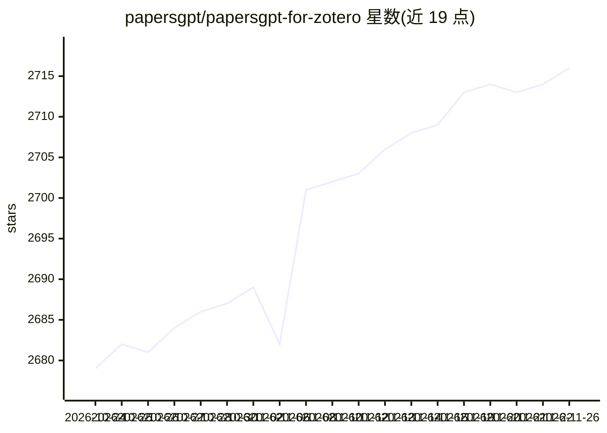

# papersgpt/papersgpt-for-zotero

⭐ 2,716 · JavaScript · AGPL-3.0 · 推送 2026-11-25 · [GitHub](https://github.com/papersgpt/papersgpt-for-zotero) · [官网](https://www.papersgpt.com) · 组织维护

**Zotero 的 AI 研究插件：全库检索、多 PDF 对话、文献雷达与 AutoPilot**

以 Zotero 插件（.xpi）形式安装的 AI 研究工具，面向需要在整个文献库上做深度研究的科研人员。它本地解析并索引库内 PDF，支持单篇/多篇/全库三种对话粒度，答案附带可点击跳转的引文；Literature Radar 订阅 arXiv、PubMed 等七个源以每日摘要推送新论文，AutoPilot 可整夜批量阅读集合并把结构化结果写入 Zotero Notes。接入 30+ 云端模型、内置可离线运行的本地模型、自定义 OpenAI 兼容端点与 Ollama；内置 MCP Server 将库暴露给 MCP 客户端。目前不可在中国大陆和 EU 使用。

## 筛选速览

| 维度 | 判定 | 备注 |
|---|---|---|
| AI 角色 | `ai-native` | 本体是模型或模型工具 |
| 许可风险 | `viral` | AGPL-3.0 |
| 部署形态 | `None` |  |
| 模型依赖 | local-ok | 支持本地模型 |
| 硬件要求 | — | 无带数字的原话,不猜 |
| 安装摩擦 | `low` | 无编译、无系统依赖或容器化 |
| 成熟度 | — | 结构信号不足 |

## 能力要点

- 全库检索与多 PDF 对比，答案带可点击跳转引文
- 30+ 云端模型、内置离线本地模型、OpenAI 兼容端点与 Ollama 三种接入方式
- 内置 Zotero MCP Server，可在不启动 Zotero 的情况下索引检索
- 本地解析、索引与检索，官方基准测试 10,000 PDF 约 7 分钟建索引

## 适用场景

- 对整个 Zotero 文献库用自然语言提问做跨论文综述
- 订阅研究主题自动追踪 arXiv/PubMed 等新论文
- 批量阅读集合并将结构化笔记写入 Zotero
- 通过 MCP 让 Claude Desktop/Cursor 等客户端访问本地文献库

## 场景标签

`科研工具` `文档问答` · 领域:知识与检索

## 证据(README 行号)

> L5: **PapersGPT** is a professional AI research tool for Zotero, built for deep research across your entire library. Mor
> L20: |**What it is**|Professional AI research agent and plugin for Zotero — deep-research your library: chat with PDFs, 
> L52: PapersGPT parses and indexes every PDF in your Zotero library **locally** — structure-aware, so headings, sections 

## 星数曲线

2026-10-24 2,679 → 2026-11-26 2,716（+37）

---
*卡片 v1 · prompt 1.4 · 生成 2026-11-26 · 置信度 high · 依据 README sha `a429363a1cf4` · [字段定义](../../DATASET.md)*
