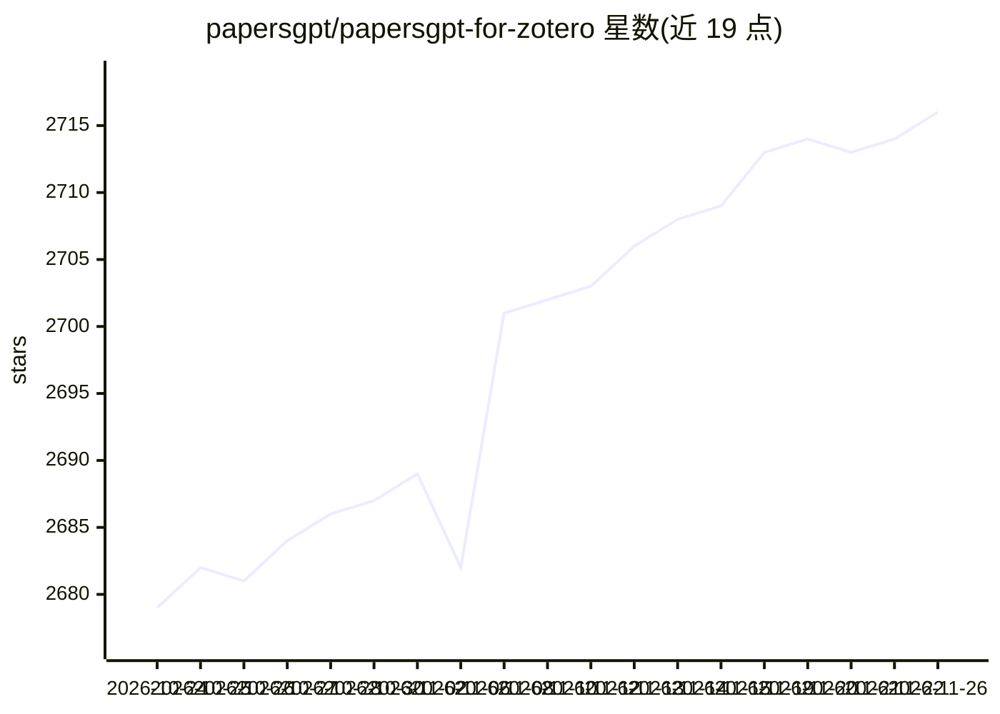

# papersgpt/papersgpt-for-zotero

⭐ 2,716 · JavaScript · AGPL-3.0 · 推送 2026-11-25 · [GitHub](https://github.com/papersgpt/papersgpt-for-zotero) · [官网](https://www.papersgpt.com) · 组织维护

**Zotero 插件：全库检索、多 PDF 对话与文献追踪的 AI 研究工具**

以 .xpi 插件形式运行在 Zotero 7-10 中的 AI 研究工具：本地解析并索引整个文献库，支持单 PDF、多 PDF 与全库范围的自然语言问答，回答附带可点击跳转的引用；Literature Radar 订阅 arXiv/PubMed 等源生成每日新文献摘要，AutoPilot 批量阅读集合并输出结构化 Zotero 笔记。内置 MCP 服务器可将文献库接入 Claude Desktop、Cursor 等客户端。支持 30+ 云端模型、内置本地模型或自定义 OpenAI 兼容端点；本地模型可完全离线运行。中国大陆与欧盟地区暂不可用。

## 筛选速览

| 维度 | 判定 | 备注 |
|---|---|---|
| AI 角色 | `ai-native` | 本体是模型或模型工具 |
| 许可风险 | `viral` | AGPL-3.0 |
| 部署形态 | `None` |  |
| 模型依赖 | local-ok | 支持本地模型 |
| 硬件要求 | — | 无带数字的原话,不猜 |
| 安装摩擦 | `low` | 无编译、无系统依赖或容器化 |
| 成熟度 | — | 结构信号不足 |

## 能力要点

- 全库检索问答，基准显示 10,000 PDF（42 GB）约 7 分钟完成索引
- Literature Radar 监测 arXiv、PubMed、Semantic Scholar 等 7 个来源的每日文献摘要
- AutoPilot 批量阅读集合并生成结构化 Zotero 笔记
- 内置 Zotero MCP Server，接入 Claude Desktop/Cursor 等 MCP 客户端

## 适用场景

- 用自然语言向整个 Zotero 文献库提问并核对引用出处
- 订阅研究方向，每天在 Zotero 内收到新文献摘要
- 夜间批量阅读上百篇论文并生成结构化笔记
- 在不启动 Zotero 的情况下通过 MCP 客户端检索文献库

## 场景标签

`科研工具` `文档问答` · 领域:知识与检索

## 证据(README 行号)

> L5: **PapersGPT** is a professional AI research tool for Zotero, built for deep research across your entire library. Mor
> L52: PapersGPT parses and indexes every PDF in your Zotero library **locally** — structure-aware, so headings, sections 

## 星数曲线

2026-10-24 2,679 → 2026-11-26 2,716（+37）

---
*卡片 v1 · prompt 1.4 · 生成 2026-11-23 · 置信度 high · 依据 README sha `3877669d371d` · [字段定义](../../DATASET.md)*
