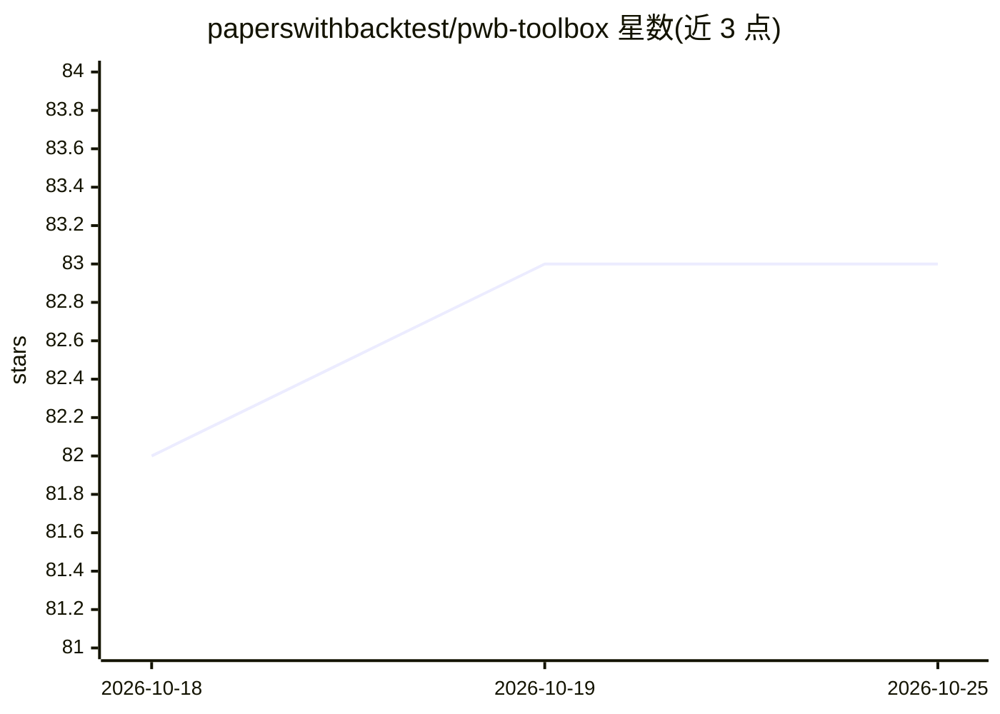

# paperswithbacktest/pwb-toolbox

⭐ 83 · Python · MIT · 推送 2026-10-19 · [GitHub](https://github.com/paperswithbacktest/pwb-toolbox) · [官网](https://paperswithbacktest.com/) · 组织维护

**为量化交易开发者提供数据集与策略回测/实盘工具的 Python 库**

面向系统化交易策略开发的 Python 工具箱：datasets 模块通过 get_pricing/load_dataset 加载债券、商品、加密货币、ETF、外汇、指数、股票等资产类别数据（需 PWB API key 或 Huggingface Hub 登录）；backtesting 模块提供 Backtrader 回测构建块；execution 模块可连接 Interactive Brokers 与 CCXT 券商实时运行策略；performance 模块分析实盘净值序列；另含 IB 服务器部署脚本（Ubuntu、Miniconda、IB TWS、cron 定时）。需 Python 3.10+。README 未展示机器学习功能的具体实现。

## 筛选速览

| 维度 | 判定 | 备注 |
|---|---|---|
| AI 角色 | `ai-enhanced` | 去掉 AI 部分产品仍成立 |
| 许可风险 | `permissive` | MIT |
| 部署形态 | `library` | 以包/库形式分发 |
| 模型依赖 | — | README 未给出锁定关系 |
| 硬件要求 | — | 无带数字的原话,不猜 |
| 安装摩擦 | `low` | 无编译、无系统依赖或容器化 |
| 成熟度 | — | 结构信号不足 |

## 能力要点

- 多资产类别数据加载（get_pricing / load_dataset，PWB API 或 Huggingface Hub）
- 基于 Backtrader 的回测构建块与 140+ 策略示例链接
- 实盘执行支持 Interactive Brokers 与 CCXT（加密货币）
- 附带 IB 服务器的 Ubuntu 安装脚本与 cron 定时运行方案

## 适用场景

- 加载历史行情数据做策略研究
- 用 Backtrader 回测交易策略
- 连接券商将策略投入实盘运行并分析净值表现

## 场景标签

`金融量化` · 领域:学习与行业

## 证据(README 行号)

> L3: The `pwb-toolbox` package is designed to provide tools and resources for systematic trading strategies. It includes 
> L41: The `pwb_toolbox.backtesting` module offers simple building blocks for running Backtrader simulations.

## 星数曲线

2026-10-18 82 → 2026-10-25 83（+1）

---
*卡片 v1 · prompt 1.4 · 生成 2026-10-24 · 置信度 low · 依据 README sha `87911e4522d9` · [字段定义](../../DATASET.md)*
