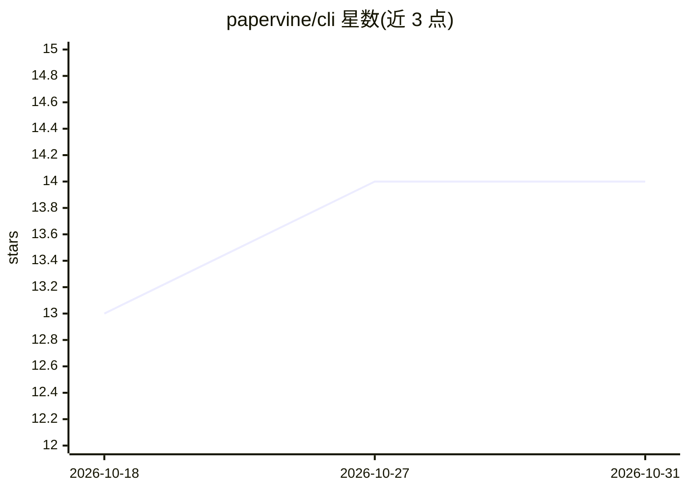

# papervine/cli

⭐ 14 · TypeScript · NOASSERTION · 推送 2026-09-03 · [GitHub](https://github.com/papervine/cli) · [官网](https://www.papervine.io) · 组织维护

**开源 MDX 文档站生成器，Mintlify 兼容并带 AI 问答助手**

面向开发者的文档站 CLI：指向一个含 MDX 与 docs.json 的目录即可启动站点，兼容 Mintlify 风格 MDX。CLI 内置预构建渲染器，无需构建工具链，约一秒启动；页面按请求渲染，写入新 MDX 即发布，无需重建或重启。提供脚手架、serve 生产命令、Vercel/Docker/任意 npm start 平台部署路径。可选 AI 助手对文档提问并给出带引用的回答，检索本地页面、无需向量库，用户自带模型（Anthropic/OpenAI/Gemini/网关/Ollama 等）。限制：无内建缓存层、访问控制与分析，每进程一个站点。

## 筛选速览

| 维度 | 判定 | 备注 |
|---|---|---|
| AI 角色 | `ai-enhanced` | 去掉 AI 部分产品仍成立 |
| 许可风险 | `none` | NOASSERTION |
| 部署形态 | `self-host` | docker 或自建部署 |
| 模型依赖 | local-ok | 支持本地模型 |
| 硬件要求 | — | 无带数字的原话,不猜 |
| 安装摩擦 | `low` | 无编译、无系统依赖或容器化 |
| 成熟度 | — | 结构信号不足 |

## 能力要点

- Mintlify 兼容的 MDX 文档渲染，docs.json 驱动
- 预构建渲染器，无编译步骤，按请求渲染即写即发布
- 可选 AI 助手：带引用回答文档问题，无向量库，本地检索
- 支持 Vercel、Docker、任意 npm start 平台自托管

## 适用场景

- 把仓库里的 MDX 文档目录直接跑成文档站
- 从 Mintlify/GitBook 迁移文档并自托管
- 让读者在文档站内提问并获得带引用的回答

## 场景标签

`文档问答` · 领域:知识与检索

## 证据(README 行号)

> L7: ***The Mintlify-compatible alternative — open-source MDX documentation.***
> L309: Ask questions about your docs and get answers with citations, from the same assistant that runs
> L313: It appears when a model is configured, and is simply absent when one isn't. You bring the model;

## 星数曲线

2026-10-18 13 → 2026-10-31 14（+1）

---
*卡片 v1 · prompt 1.4 · 生成 2026-10-31 · 置信度 high · 依据 README sha `648166296c5d` · [字段定义](../../DATASET.md)*
