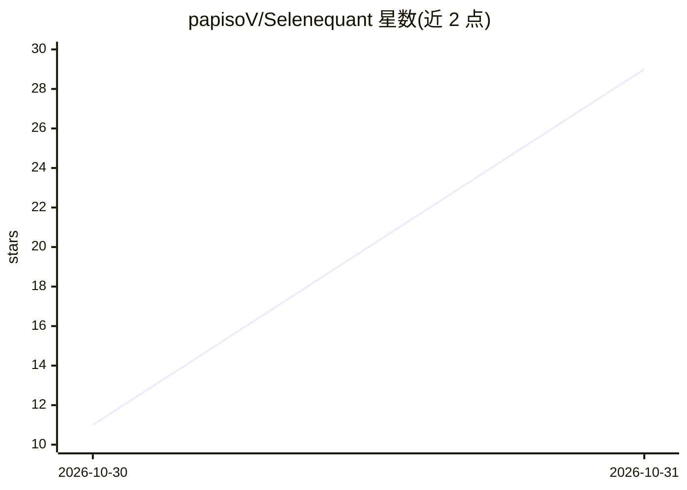

# papisoV/Selenequant

⭐ 29 · Python · AGPL-3.0 · 推送 2026-10-29 · [GitHub](https://github.com/papisoV/Selenequant) · 个人维护 · 中文 README

**本地优先的 AI 量化研究平台：问题持久化、结论版本化并自动召回**

面向量化研究者的本地一体化平台：以“持久问题”为研究单元，AI 研究组织（三视角委员会、五阶段日循环、ReAct Agent 运行时）对问题运行真实实验，产出带编号、可引用先前版本及其证据的结论，且存储结论会被自动召回进入下一次调用。底层为完整量化栈：6 源行情数据、49 个策略模板、含 DSR/PBO/purged K-fold 等抗过拟合统计的回测引擎、FastAPI 服务（523 端点）与 142 页 Web 应用。支持 OpenAI 兼容端点及 Ollama 本地模型。仓库声明为早期阶段、以精选快照方式公开（PR 无合并分支）。需 Python 3.11+ 与 Node 20+，从源码克隆安装。

## 筛选速览

| 维度 | 判定 | 备注 |
|---|---|---|
| AI 角色 | `ai-native` | 本体是模型或模型工具 |
| 许可风险 | `viral` | AGPL-3.0 |
| 部署形态 | `library` | 以包/库形式分发 |
| 模型依赖 | local-ok | 支持本地模型 |
| 硬件要求 | — | 无带数字的原话,不猜 |
| 安装摩擦 | `low` | 无编译、无系统依赖或容器化 |
| 成熟度 | `idea` | |

## 能力要点

- 问题持久化：结论按版本编号，新版本可引用旧版本及其证据
- AI 研究组织：三视角委员会（经验主义者/记录者/挑战者）+ 主席撰写修订
- 抗过拟合统计套件：DSR、PBO（CSCV）、purged K-fold、Monte Carlo、walk-forward
- 适配 OpenAI 兼容端点与 Ollama 的本地 LLM 接入层，含优先级链路由与健康探测

## 适用场景

- 持续跟踪某个量化问题，让每次结论建立在此前证据之上
- 用本地 LLM 运行多 agent 量化研究循环而不依赖云端
- 对策略回测做过拟合检验（PBO/DSR/walk-forward）后决定是否推进

## 场景标签

`多智能体` `金融量化` · 领域:Agent 开发

## 证据(README 行号)

> L3:  A local-first AI quant research organization. Questions are persistent, conclusions are versioned, and the past cha
> L104: The whole product is one loop. A question persists; research produces evidence and numbered revisions; each revisi
> L122: - **Three-perspective council**: an empiricist (only evidence-anchored history), a recordist (only unvalidated lea

## 星数曲线

2026-10-30 11 → 2026-10-31 29（+18）

---
*卡片 v1 · prompt 1.4 · 生成 2026-10-31 · 置信度 high · 依据 README sha `694a302803e5` · [字段定义](../../DATASET.md)*
