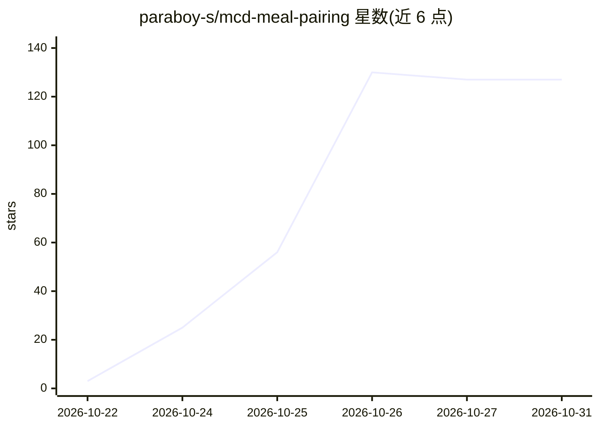

# paraboy-s/mcd-meal-pairing

⭐ 127 · Python · 推送 2026-10-22 · [GitHub](https://github.com/paraboy-s/mcd-meal-pairing) · [官网](https://paraboy-s.github.io/mcd-meal-pairing/preview.html) · 个人维护 · 中文 README

**给点麦当劳的人算最优配餐的 Agent Skill：确定性求解、可追溯**

面向 WorkBuddy/Claude 类 agent 的麦当劳配餐决策 Skill（SKILL.md + Python 脚本）：LLM 只做意图理解，配对、热量、券与拼单分配全部由确定性引擎计算，数字可追溯到 MCP 工具返回。六个引擎覆盖枚举求解、品味指纹（9 维、带置信度）、券判定、反事实解释与 max-min 拼单分配。需麦当劳 MCP Token 才能取实时数据，可用 --demo 固定数据零依赖验证；仅做决策不下单，为大赛参赛作品、非官方产品。

## 筛选速览

| 维度 | 判定 | 备注 |
|---|---|---|
| AI 角色 | `ai-ecosystem` | LLM/agent 周边工具 |
| 许可风险 | `none` | — |
| 部署形态 | `None` |  |
| 模型依赖 | — | README 未给出锁定关系 |
| 硬件要求 | — | 无带数字的原话,不猜 |
| 安装摩擦 | `low` | 无编译、无系统依赖或容器化 |
| 成熟度 | — | 结构信号不足 |

## 能力要点

- 枚举 1881 种搭配剪枝出 1326 组可行解，输出三档方案与淘汰理由
- LLM 不参与算钱，价格/热量/用券由确定性代码计算并可对账
- max-min 公平拼单分配与券的生效日/时段/渠道判定
- 9 维品味指纹带置信度，附 40 场景基线对比与消融实验

## 适用场景

- 午餐预算内要一份已经算完的配餐方案
- 控卡或忌口场景下按硬约束筛选搭配
- 手里有多张券时判断用哪张、凑单是否真优惠
- 2–5 人拼单时做公平分配与让步说明

## 场景标签

`推荐系统` · 领域:学习与行业

## 证据(README 行号)

> L45: 这个 Skill 的做法是：**把「说话」和「算账」拆开。**
> L160:     ↓  LLM：只做意图理解
> L266: SKILL.md                  ← 智能体执行指令（本 Skill 的核心）

## 星数曲线

2026-10-22 3 → 2026-10-31 127（+124）

---
*卡片 v1 · prompt 1.4 · 生成 2026-10-24 · 置信度 mid · 依据 README sha `e47a744beff5` · [字段定义](../../DATASET.md)*
