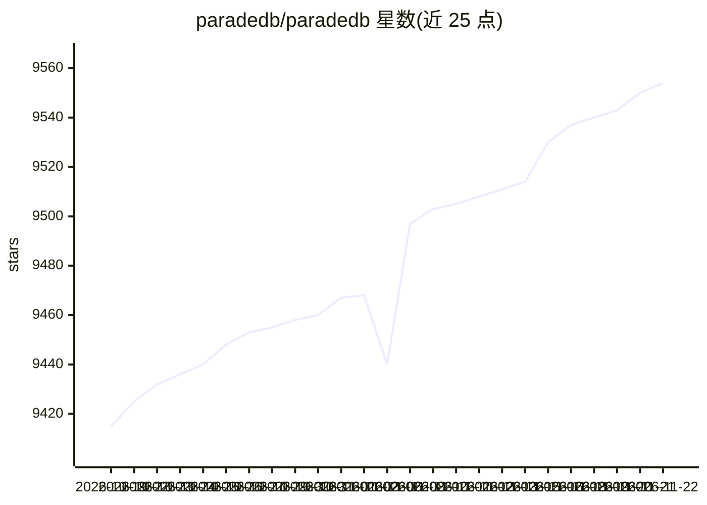

# paradedb/paradedb

⭐ 9,554 · Rust · AGPL-3.0 · 推送 2026-11-21 · [GitHub](https://github.com/paradedb/paradedb) · [官网](https://paradedb.com) · 组织维护

**给 Postgres 提供全文/向量检索与分析的扩展**

ParadeDB 是一个 Postgres 扩展（pg_search），通过自定义索引在单一数据库内提供全文检索、向量检索、混合检索、BM25 评分、过滤、分面、聚合与 JOIN，保留标准 SQL 与 ACID 事务。内部依赖 pgrx、Tantivy、Apache DataFusion。本地以 Docker 脚本安装运行，亦提供云托管与自托管部署；另提供 ORM 集成与 AI Agent 相关入口（Agent Skills、MCP、Cursor 插件）。AGPL v3 许可，另有企业支持与商业授权渠道。

## 筛选速览

| 维度 | 判定 | 备注 |
|---|---|---|
| AI 角色 | `ai-enhanced` | 去掉 AI 部分产品仍成立 |
| 许可风险 | `viral` | AGPL-3.0 |
| 部署形态 | `self-host` | docker 或自建部署 |
| 模型依赖 | — | README 未给出锁定关系 |
| 硬件要求 | — | 无带数字的原话,不猜 |
| 安装摩擦 | `low` | 无编译、无系统依赖或容器化 |
| 成熟度 | — | 结构信号不足 |

## 能力要点

- pg_search 扩展：BM25 全文检索、Top K、高亮、分词器
- 向量检索与混合检索，应用数据与搜索引擎同库
- 列式存储与 OLAP 聚合（Apache DataFusion）
- 与 Django/SQLAlchemy/Rails 等 ORM 集成，提供 MCP 与 Cursor 插件

## 适用场景

- 在 Postgres 内实现应用数据的全文与向量检索
- 用 SQL 做 BM25 评分、过滤与分面搜索
- 同一数据库承担 OLTP 与 OLAP 分析负载

## 场景标签

`语义搜索` `向量数据库` · 领域:知识与检索

## 证据(README 行号)

> L8:  One Postgres for your application data, full-text search, vector retrieval, and aggregations.
> L33: ParadeDB upgrades Postgres with a custom index for fast full-text and vector search, BM25 scoring, filters, facets,
> L74: ### AI Agents

## 星数曲线

2026-10-19 9,415 → 2026-11-22 9,554（+139）

---
*卡片 v1 · prompt 1.4 · 生成 2026-11-22 · 置信度 high · 依据 README sha `b6a27c27671e` · [字段定义](../../DATASET.md)*
