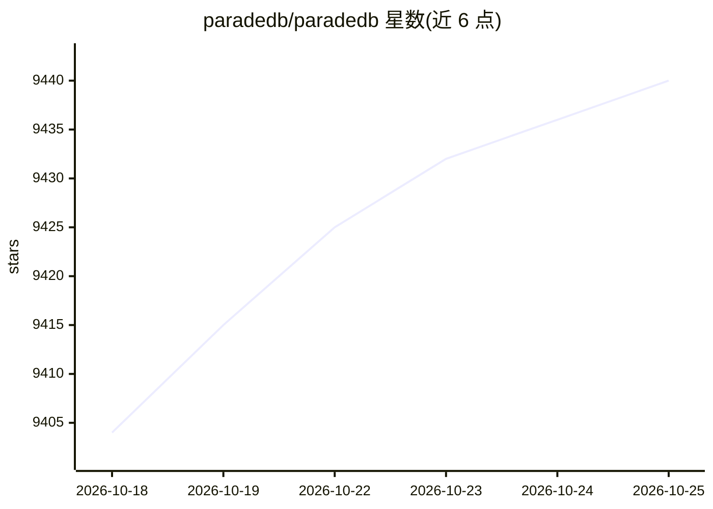

# paradedb/paradedb

⭐ 9,440 · Rust · AGPL-3.0 · 推送 2026-10-24 · [GitHub](https://github.com/paradedb/paradedb) · [官网](https://paradedb.com) · 组织维护

**Postgres 扩展：全文检索、向量检索与分析聚合一体化**

以 Postgres 扩展形式在数据库内提供 BM25 全文检索、向量与混合检索、过滤、分面、列式存储聚合和 JOIN 能力，使应用数据与搜索引擎共用一个数据库，走标准 SQL 与 ACID 事务。底层集成 pgrx、Tantivy 与 Apache DataFusion 等 Rust 库。面向需要检索与分析能力的 Postgres 使用者，提供 Docker 一键启动、云托管与自托管部署选项，支持主流 ORM 与 AI Agent（MCP、Cursor 插件）集成。社区版采用 AGPLv3 许可，并提供商业许可渠道。

## 筛选速览

| 维度 | 判定 | 备注 |
|---|---|---|
| AI 角色 | `ai-enhanced` | 去掉 AI 部分产品仍成立 |
| 许可风险 | `viral` | AGPL-3.0 |
| 部署形态 | `self-host` | docker 或自建部署 |
| 模型依赖 | — | README 未给出锁定关系 |
| 硬件要求 | — | 无带数字的原话,不猜 |
| 安装摩擦 | `low` | 无编译、无系统依赖或容器化 |
| 成熟度 | — | 结构信号不足 |

## 能力要点

- Postgres 内置 BM25 全文检索、向量与混合检索
- 列式存储聚合、分面、过滤与 JOIN
- 集成 Tantivy 与 Apache DataFusion 的 Rust 实现
- 提供 ORM 集成与 MCP、Cursor 插件等 AI Agent 接入

## 适用场景

- 在 Postgres 中直接做全文与向量混合检索，避免外置搜索引擎
- RAG 应用中用同一数据库管理业务数据与向量召回
- 在库内完成分析聚合与分面统计

## 场景标签

`语义搜索` `向量数据库` · 领域:知识与检索

## 证据(README 行号)

> L8:  One Postgres for your application data, full-text search, vector retrieval, and aggregations.
> L33: ParadeDB upgrades Postgres with a custom index for fast full-text and vector search, BM25 scoring, filters, facets,

## 星数曲线

2026-10-18 9,404 → 2026-10-25 9,440（+36）

---
*卡片 v1 · prompt 1.4 · 生成 2026-10-20 · 置信度 high · 依据 README sha `98325a42c178` · [字段定义](../../DATASET.md)*
