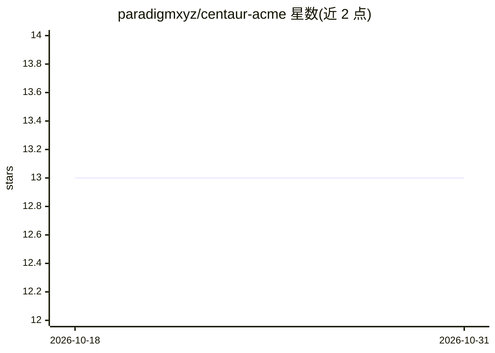

# paradigmxyz/centaur-acme

⭐ 13 · Python · NOASSERTION · 推送 2026-06-02 · [GitHub](https://github.com/paradigmxyz/centaur-acme) · [官网](https://centaur.run/extend/acme-example) · 组织维护

**Centaur 组织扩展模板：打包工具/工作流/技能的 overlay 镜像**

paradigmxyz 的 Centaur 平台组织级 overlay 模板仓库：将 API 工具、durable 工作流、sandbox 技能与系统提示词打包为可复用的 Docker overlay 镜像，由 Centaur Helm chart 在运行时挂载到 API 与 sandbox pod。用户通过 GitHub 模板或 fork 起步，替换 ACME 示例后构建发布镜像，凭据需走 Centaur secret 系统而非入库。内含 Python/Rust/Go 三种运行时的 CLI 工具示例与每日简报工作流。

## 筛选速览

| 维度 | 判定 | 备注 |
|---|---|---|
| AI 角色 | `ai-ecosystem` | LLM/agent 周边工具 |
| 许可风险 | `none` | NOASSERTION |
| 部署形态 | `self-host` | docker 或自建部署 |
| 模型依赖 | — | README 未给出锁定关系 |
| 硬件要求 | — | 无带数字的原话,不猜 |
| 安装摩擦 | `low` | 无编译、无系统依赖或容器化 |
| 成熟度 | — | 结构信号不足 |

## 能力要点

- tools/workflows/skills/SYSTEM_PROMPT 四类扩展点打包为 overlay 镜像
- Helm values 指定镜像并由 chart 挂载到 API 与 sandbox pod
- 含 Python/Rust/Go 跨运行时的源码构建工具示例
- 凭据不入库，通过 Centaur secret 系统请求

## 适用场景

- 为组织定制 Centaur 的工具与技能扩展
- 将组织专属 agent 行为规范打包进 sandbox 提示词
- 配合 GitOps 流程（centaur-acme-infra）交付扩展

## 场景标签

 · 领域:AI agent 基础设施

## 证据(README 行号)

> L15: `centaur-acme` is a public, forkable template for creating an organization
> L45: The template demonstrates the extension points an organization normally owns:

## 星数曲线

2026-10-18 13 → 2026-10-31 13（+0）

---
*卡片 v1 · prompt 1.4 · 生成 2026-10-31 · 置信度 high · 依据 README sha `54da01a85383` · [字段定义](../../DATASET.md)*
