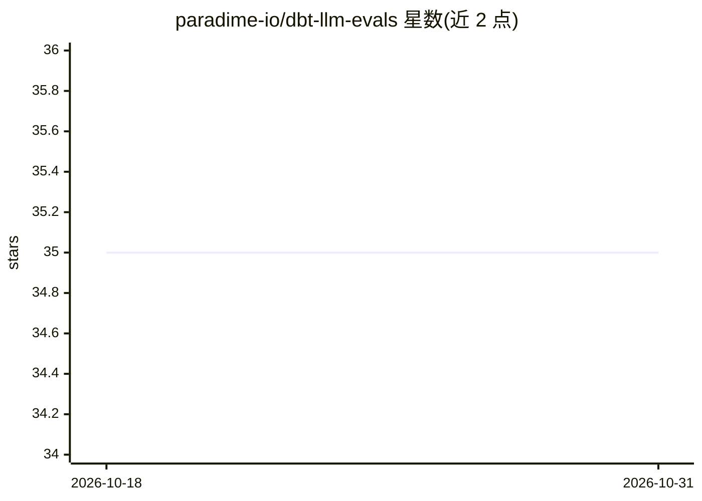

# paradime-io/dbt-llm-evals

⭐ 35 · Python · NOASSERTION · 推送 2026-02-10 · [GitHub](https://github.com/paradime-io/dbt-llm-evals) · [官网](https://www.paradime.io/) · 组织维护

**给 dbt 项目的数据仓库内 LLM 输出评测包，无数据外流**

dbt 包形式的 LLM 评测监控工具：通过 post-hook 自动捕获 AI 模型的输入、输出与 prompt，使用 LLM-as-a-Judge 框架在数据仓库内部（Snowflake Cortex、BigQuery Vertex AI、Databricks AI Functions）运行评审模型，按 accuracy/relevance/tone 等 1-10 分尺度打分并给出推理；支持自动基线创建与版本管理、漂移检测与告警模型。面向在仓库内生成 AI 内容并需持续监控质量的 dbt 数据团队；限制为依赖三大仓库的原生 AI 函数，不调用外部 API。以 packages.yml 添加并 dbt deps 安装。

## 筛选速览

| 维度 | 判定 | 备注 |
|---|---|---|
| AI 角色 | `ai-ecosystem` | LLM/agent 周边工具 |
| 许可风险 | `none` | NOASSERTION |
| 部署形态 | `None` |  |
| 模型依赖 | — | README 未给出锁定关系 |
| 硬件要求 | — | 无带数字的原话,不猜 |
| 安装摩擦 | `low` | 无编译、无系统依赖或容器化 |
| 成熟度 | — | 结构信号不足 |

## 能力要点

- post-hook 自动捕获 AI 模型的输入/输出/prompt
- LLM-as-a-Judge 在仓库内运行，零外部 API 调用与数据外流
- 自动基线创建与多版本基线管理（v1.0/v2.0）
- 内置漂移检测、性能汇总与告警模型，5 类评测维度 1-10 打分

## 适用场景

- 在 Snowflake/BigQuery/Databricks 上持续监控生产 LLM 输出质量
- 对 AI 生成内容按准确度、相关性等维度自动打分并存档
- 模型迭代时切换基线版本并检测输出漂移

## 场景标签

`模型评测` · 领域:评测与运维

## 证据(README 行号)

> L11: A complete dbt™ package for evaluating LLM outputs directly within your data warehouse using warehouse-native AI fu
> L38: `dbt_llm_evals` allows teams to automatically evaluate AI/LLM-generated content in their dbt™ projects using a **ju
> L42: - ✅ **Warehouse-Native**: Uses Snowflake Cortex, BigQuery Vertex AI, or Databricks AI Functions

## 星数曲线

2026-10-18 35 → 2026-10-31 35（+0）

---
*卡片 v1 · prompt 1.4 · 生成 2026-10-25 · 置信度 high · 依据 README sha `c36fbc620d4e` · [字段定义](../../DATASET.md)*
