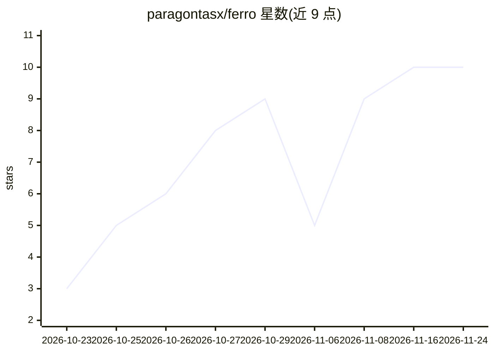

# paragontasx/ferro

⭐ 10 · C++ · MIT · 推送 2026-11-18 · [GitHub](https://github.com/paragontasx/ferro) · 个人维护

**面向 Intel N100 级 iGPU 的 OpenCL 推理引擎，单二进制自托管**

用 C++ 编写的本地推理引擎，面向 Intel 低功耗 SoC（N100 级）的集成 GPU，通过 OpenCL int8 DP4A 运行，带自动 CPU 回退。单个二进制从 GGUF 元数据自动识别三类模型：EmbeddingGemma-2 生成嵌入、LiquidAI d1 决策模型做单次前向的类型化回答、LFM2/LFM2.5/Gemma4 做文本生成；内置 OpenAI 兼容服务器与 /v1/systemone 协议。需自行编译（需 OpenCL 头文件，Mesa rusticl 即可），模型需从 Hugging Face 下载。

## 筛选速览

| 维度 | 判定 | 备注 |
|---|---|---|
| AI 角色 | `ai-ecosystem` | LLM/agent 周边工具 |
| 许可风险 | `permissive` | MIT |
| 部署形态 | `None` |  |
| 模型依赖 | — | README 未给出锁定关系 |
| 硬件要求 | — | 无带数字的原话,不猜 |
| 安装摩擦 | `high` | 编译与系统依赖俱全 |
| 成熟度 | — | 结构信号不足 |

## 能力要点

- 单 C++ 二进制直接加载 GGUF，默认在 iGPU 运行，CPU 自动回退
- OpenAI 兼容服务器与 llama.cpp /v1/systemone 决策协议
- 批量不变性契约：流式解码结果与其他并发流数量无关
- README 附 bench/RESULTS.md 与脚本的可复现基准数据

## 适用场景

- 在 N100 低功耗小主机上自托管聊天与补全服务
- 批量对工单/状态文本跑 yes/no、选项类决策回答
- 本地生成句子/图像/音频嵌入用于检索
- 将决策模型推理从 CPU 迁到 iGPU 以缩短响应时间

## 场景标签

`推理引擎` · 领域:训练与推理

## 证据(README 行号)

> L5: **A tiny inference engine for Intel low-power SoCs (N100-class).** One C++ binary, no Python, no
> L6: framework — it loads GGUFs directly and runs them **on the integrated GPU by default** (OpenCL, int8
> L13: |**LiquidAI LFM2 / LFM2.5** (1.2B-Thinking, 350M, ...)|`lfm2` (causal)|`generate` / `serve --lm`|text generation: c

## 星数曲线

2026-10-23 3 → 2026-11-24 10（+7）

---
*卡片 v1 · prompt 1.4 · 生成 2026-11-19 · 置信度 high · 依据 README sha `bbba0adf2f21` · [字段定义](../../DATASET.md)*
