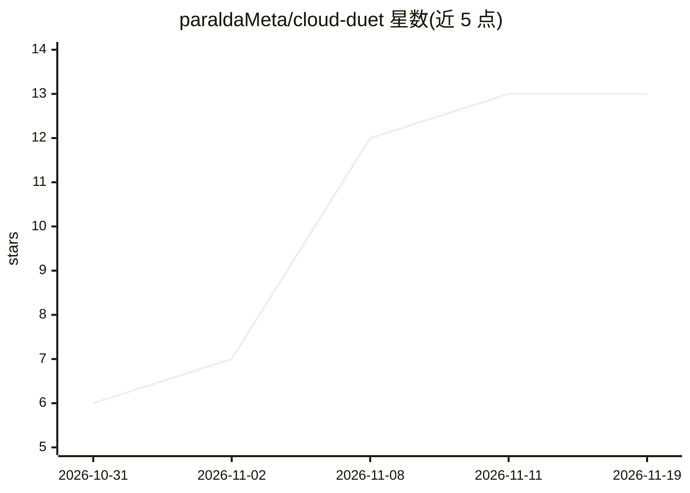

# paraldaMeta/cloud-duet

⭐ 13 · TypeScript · MIT · 推送 2026-10-30 · [GitHub](https://github.com/paraldaMeta/cloud-duet) · 个人维护 · 中文 README

**面向个人与团队的主动式 AI 工作助手，后台代办、发信付款先审批**

基于 Next.js 的自托管 Web 应用：每天生成主动简报，模型通过工具循环在后台执行邮件、任务、浏览器代操作、文档制作等工作；发邮件、付款、提交表单等写入操作默认须用户审批确认。支持 QQ/微信/飞书/钉钉登录，可直连 QQ 邮箱、飞书、钉钉、企业微信、语雀与微信通知；未配置密钥时可离线运行内置演示引擎。安装为 npm install + npm run dev，可在本地或任意 Node 平台部署。

## 筛选速览

| 维度 | 判定 | 备注 |
|---|---|---|
| AI 角色 | `ai-native` | 本体是模型或模型工具 |
| 许可风险 | `permissive` | MIT |
| 部署形态 | `library` | 以包/库形式分发 |
| 模型依赖 | — | README 未给出锁定关系 |
| 硬件要求 | — | 无带数字的原话,不猜 |
| 安装摩擦 | `low` | 无编译、无系统依赖或容器化 |
| 成熟度 | — | 结构信号不足 |

## 能力要点

- 模型工具循环（最多 12 轮）驱动后台任务与浏览器代操作（Playwright 驱动 Chrome）
- 邮件、付款、提交等写入操作默认须审批卡片确认，并含禁止交易转账等护栏
- 支持 DeepSeek、通义千问、Kimi、智谱、豆包、硅基流动、MiniMax 等快捷配置
- 直连 QQ 邮箱/163、飞书、钉钉、企业微信、语雀与微信通知（Server酱/PushPlus）

## 适用场景

- 让 AI 每天主动推送工作简报并代为执行例行任务
- 通过审批卡片控制 AI 发邮件、付款、提交表单等敏感操作
- 在飞书、钉钉、企业微信等国内办公环境中接入助手通知与消息

## 场景标签

`AI 助手` `浏览器自动化` · 领域:效率与自动化

## 证据(README 行号)

> L3: 开源的主动式 AI 工作助手：每天给你简报，在后台替你干活，发邮件、付款、提交表单之前一定先问你。界面默认简体中文，可在「资料 → 语言」切换为 English。
> L88: 配置密钥后，聊天、任务线程与发起的建议走工具循环（`src/lib/server/agent/`）。模型决定调用哪些工具，应用显示对应 live 状态（如「正在搜索邮件」「正在查记忆」…），结果回传模型直至结束（最多 12 轮）。

## 星数曲线

2026-10-31 6 → 2026-11-19 13（+7）

---
*卡片 v1 · prompt 1.4 · 生成 2026-11-18 · 置信度 high · 依据 README sha `77f2b2fdca3d` · [字段定义](../../DATASET.md)*
