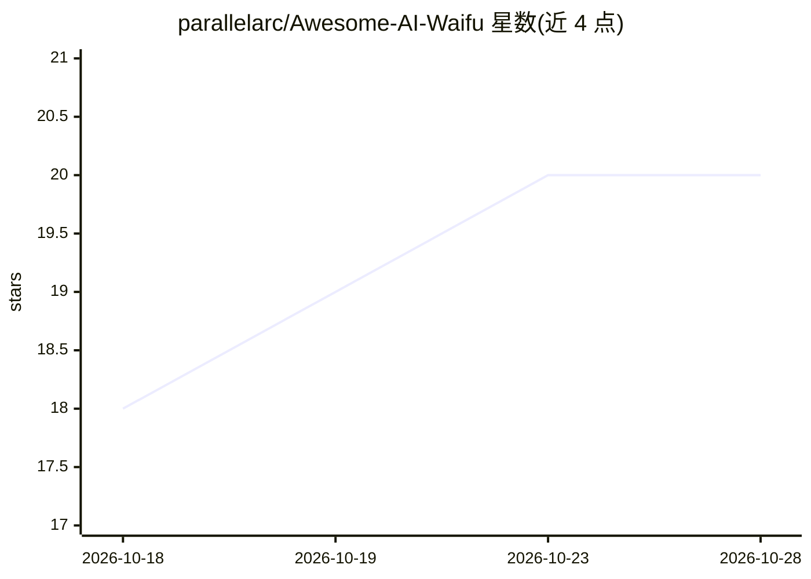

# parallelarc/Awesome-AI-Waifu

⭐ 20 · NOASSERTION · 推送 2026-05-05 · [GitHub](https://github.com/parallelarc/Awesome-AI-Waifu) · 个人维护 · 中文 README

**AI Waifu/智能伴侣资源策展清单：框架、平台、模型与社区**

面向构建 AI 陪伴角色（AI Waifu）的开发者与爱好者的 curated list，收录专用框架（AIAvatarKit、ChatdollKit）、通用 AI 基础设施（LangChain、letta、OpenClaw 等）、应用与平台（AIRI、SillyTavern、Soul of Waifu 等）及社区资源。README 以大量篇幅界定 AI Waifu 的概念与核心能力（LLM 对话、长期记忆与 RAG、多模态交互、Agent 技能、本地优先隐私），条目附 star 数与一句话说明，数据截至 2026 年 5 月。以 CC0-1.0 发布，欢迎 PR。

## 筛选速览

| 维度 | 判定 | 备注 |
|---|---|---|
| AI 角色 | `ai-knowledge` | 知识聚合/清单类 |
| 许可风险 | `none` | NOASSERTION |
| 部署形态 | `None` |  |
| 模型依赖 | — | README 未给出锁定关系 |
| 硬件要求 | — | 无带数字的原话,不猜 |
| 安装摩擦 | `low` | 无编译、无系统依赖或容器化 |
| 成熟度 | — | 结构信号不足 |

## 能力要点

- 收录 AI Waifu 专用框架与通用 AI 基础设施两大类工具
- 系统梳理 AI Waifu 五大核心能力定义（对话/记忆/多模态/Agent/隐私）
- 条目附 star 数与功能说明，标注更新时间
- 含社区资源与贡献指南

## 适用场景

- 寻找构建 AI 陪伴角色所需的框架与工具
- 了解 AI Waifu 领域的项目生态与选型参考
- 查找本地自托管与隐私优先的伴侣 AI 方案

## 场景标签

`精选清单` · 领域:学习与行业

## 证据(README 行号)

> L8: A curated list of AI Waifu related resources, including tools, frameworks, models, applications, and community resou
> L51: ## Frameworks and Tools

## 星数曲线

2026-10-18 18 → 2026-10-28 20（+2）

---
*卡片 v1 · prompt 1.4 · 生成 2026-10-28 · 置信度 high · 依据 README sha `6374065e6de1` · [字段定义](../../DATASET.md)*
