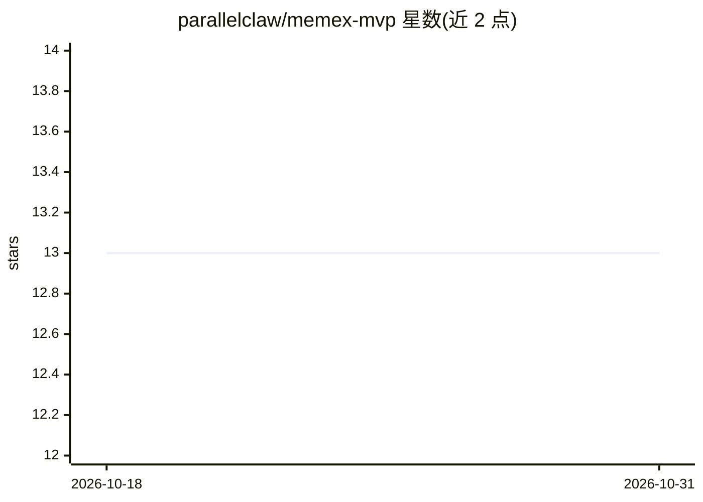

# parallelclaw/memex-mvp

⭐ 13 · JavaScript · MIT · 推送 2026-06-14 · [GitHub](https://github.com/parallelclaw/memex-mvp) · 个人维护

**本地优先的 MCP 记忆服务器：聚合索引 AI 与 Telegram 对话供检索**

将 Claude Code、Claude Cowork、Cursor、OpenClaw 会话、Obsidian 笔记及选定 Telegram 导出解析进单一 SQLite+FTS5 语料库，通过 MCP 工具或终端 CLI 向任意 MCP 兼容客户端（Claude Code/Cursor/Cline 等）提供全文检索，支持按对话、时间点过滤。带 chokidar 监听的自动采集守护进程、Claude Code SessionStart 上下文注入 hook、Telegram 导出隐私门控（allow-list + 待审队列）及只读本地 Web 仪表盘。数据全部留在本机，无出站调用。要求 Node ≥ 20。

## 筛选速览

| 维度 | 判定 | 备注 |
|---|---|---|
| AI 角色 | `ai-ecosystem` | LLM/agent 周边工具 |
| 许可风险 | `permissive` | MIT |
| 部署形态 | `library` | 以包/库形式分发 |
| 模型依赖 | — | README 未给出锁定关系 |
| 硬件要求 | — | 无带数字的原话,不猜 |
| 安装摩擦 | `low` | 无编译、无系统依赖或容器化 |
| 成熟度 | — | 结构信号不足 |

## 能力要点

- 多来源（Claude Code/Cursor/OpenClaw/Obsidian/Telegram）统一入 SQLite+FTS5 可检索语料
- memex-sync 守护进程自动采集与历史回填
- Claude Code SessionStart hook 自动注入 500-1500 token 项目上下文
- Telegram 导出隐私门控与四种待审通知渠道，opt-in 只读 Web 仪表盘

## 适用场景

- 让 Claude Code/Cursor 等 AI 客户端检索我过去的所有 AI 对话与笔记
- 跨工具汇总 AI 会话记录并做全文与按时间点搜索
- 把网页和 AI 对话分享链接存入本地记忆供日后检索

## 场景标签

`Agent 记忆` · 领域:Agent 开发

## 证据(README 行号)

> L11: A local-first MCP server that indexes **every conversation you have with AI** — Claude Code, Claude Cowork, Cursor,
> L136: When called **without arguments** (`memex`), the binary still runs as an MCP stdio server (the way Claude Code / C

## 星数曲线

2026-10-18 13 → 2026-10-31 13（+0）

---
*卡片 v1 · prompt 1.4 · 生成 2026-10-31 · 置信度 high · 依据 README sha `4174abdf5caa` · [字段定义](../../DATASET.md)*
