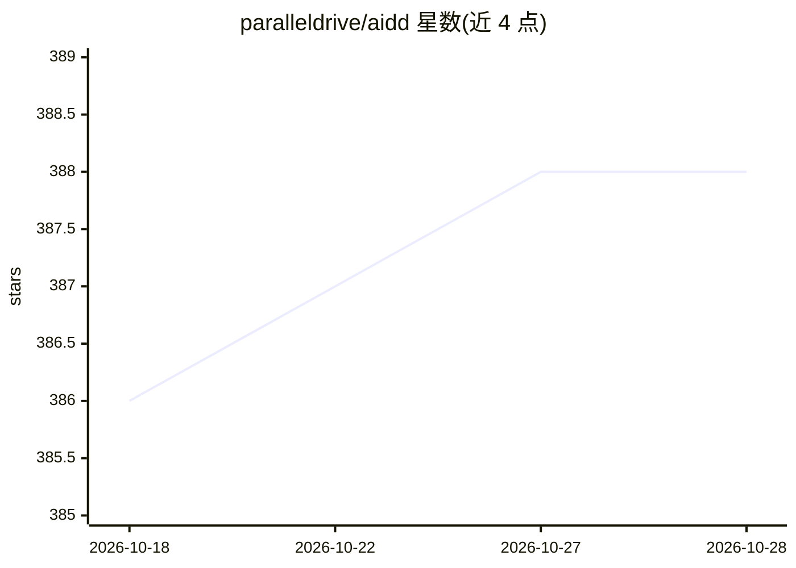

# paralleldrive/aidd

⭐ 388 · JavaScript · MIT · 推送 2026-06-12 · [GitHub](https://github.com/paralleldrive/aidd) · 组织维护

**AI 驱动开发框架：让 AI agent 写出的代码可维护、安全**

面向使用 AI agent 编码的开发者的框架：提供 CLI 项目引导、agent 运行时工作流（从产品发现 /discover → 任务规划 /task → TDD 执行 /execute 到代码评审 /review）、SudoLang 提示词伪代码语言、可选的组合式 Node/Next.js 服务端框架，以及技能与组件库。以 npx aidd 命令将完整 agent 编排系统克隆到项目 ai/ 目录，面向 Cursor 优化但兼容任意编辑器，需 Node.js 16+ 与任意足够强的 LLM。

## 筛选速览

| 维度 | 判定 | 备注 |
|---|---|---|
| AI 角色 | `ai-ecosystem` | LLM/agent 周边工具 |
| 许可风险 | `permissive` | MIT |
| 部署形态 | `library` | 以包/库形式分发 |
| 模型依赖 | — | README 未给出锁定关系 |
| 硬件要求 | — | 无带数字的原话,不猜 |
| 安装摩擦 | `low` | 无编译、无系统依赖或容器化 |
| 成熟度 | — | 结构信号不足 |

## 能力要点

- CLI 一键引导项目（npx aidd），生成 ai/ 目录的技能、命令与工作流
- /discover → /task → /execute → /review 的 TDD 规范驱动开发工作流
- SudoLang：带类型与控制流的提示词伪代码语言
- 可选组合式服务端框架（含 better-auth 会话与 Passkey 认证中间件）

## 适用场景

- 用 Claude Code 等 agent 开发时保持代码可维护、有测试与规范
- 在 Cursor 等 AI 编辑器中接入结构化的产品发现到交付工作流
- 为 Node/Next.js 项目搭建类型安全的组合式后端与认证

## 场景标签

`编码 Agent` `Agent 框架` · 领域:Agent 开发

## 证据(README 行号)

> L27: AIDD Framework is a collection of reusable agent skills, agent orchestration systems, traditional symbolic code lib
> L302: The **AI Driven Development (AIDD)** CLI tool clones the complete AI agent orchestration system to any directory.

## 星数曲线

2026-10-18 386 → 2026-10-28 388（+2）

---
*卡片 v1 · prompt 1.4 · 生成 2026-10-21 · 置信度 high · 依据 README sha `8ff31f8cbfc1` · [字段定义](../../DATASET.md)*
