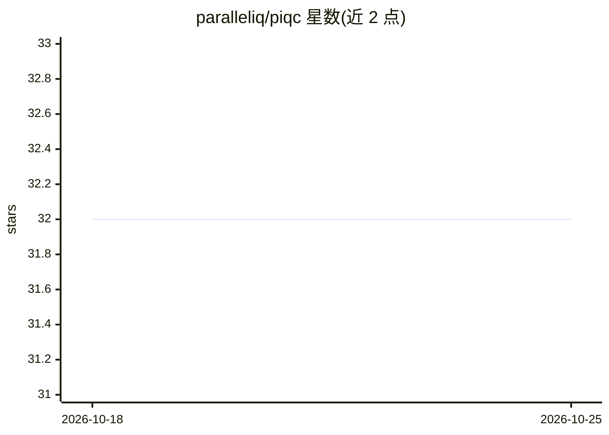

# paralleliq/piqc

⭐ 32 · Python · Apache-2.0 · 推送 2026-10-20 · [GitHub](https://github.com/paralleliq/piqc) · [官网](https://www.paralleliq.ai) · 组织维护

**Kubernetes 推理集群 GPU 浪费扫描器：一条命令找出闲置与错配**

面向 Kubernetes GPU 推理集群的只读事实采集工具：自动发现 vLLM 与 Ray Serve 推理部署，通过 nvidia-smi 与 vLLM API 采集 GPU 利用率、KV cache、token 吞吐等指标，检测闲置分配、GPU 档位错配、暗容量、碎片化与排队负载，输出含 MFU、$/1K tokens 与日/年浪费金额的成本报告；事实包可对接 Paralleliq 优化平台，也可独立运行。提供 K8s Job、pipx/PyPI、Docker、源码四种安装方式；硬件采集以插件扩展（Nvidia/AMD）。

## 筛选速览

| 维度 | 判定 | 备注 |
|---|---|---|
| AI 角色 | `ai-ecosystem` | LLM/agent 周边工具 |
| 许可风险 | `permissive` | Apache-2.0 |
| 部署形态 | `self-host` | docker 或自建部署 |
| 模型依赖 | local-ok | 支持本地模型 |
| 硬件要求 | — | 无带数字的原话,不猜 |
| 安装摩擦 | `low` | 无编译、无系统依赖或容器化 |
| 成熟度 | — | 结构信号不足 |

## 能力要点

- 自动发现 vLLM/Ray Serve 部署并采集 GPU 与运行时指标（KV cache、P50/P95/P99 延迟等）
- 检测闲置分配、档位错配、暗容量、碎片化等浪费并折算 $/天 与年化成本
- 只读、无 agent、无 sidecar，支持 K8s Job / pipx / Docker / 源码多种运行方式
- 硬件采集插件化，内置 NVIDIA 与 AMD Instinct（ROCm）插件

## 适用场景

- 盘点 K8s 集群中 GPU 推理支出的浪费情况
- 识别跑在过高 GPU 档位上的模型并估算成本差
- 以定时扫描持续跟踪暗容量与闲置趋势

## 场景标签

`MLOps` `LLM 可观测性` · 领域:评测与运维

## 证据(README 行号)

> L23: piqc is an open-source inference fact collector for Kubernetes clusters. It collects model-aware facts — what is ru
> L29:   └── inference collector (vLLM-native)     ← collects model, GPU, KV cache, throughput facts
> L43: It works with any Kubernetes cluster running GPU inference workloads — GKE, EKS, AKS, on-prem, or bare metal. vLLM 

## 星数曲线

2026-10-18 32 → 2026-10-25 32（+0）

---
*卡片 v1 · prompt 1.4 · 生成 2026-10-25 · 置信度 high · 依据 README sha `693c02ead1d9` · [字段定义](../../DATASET.md)*
