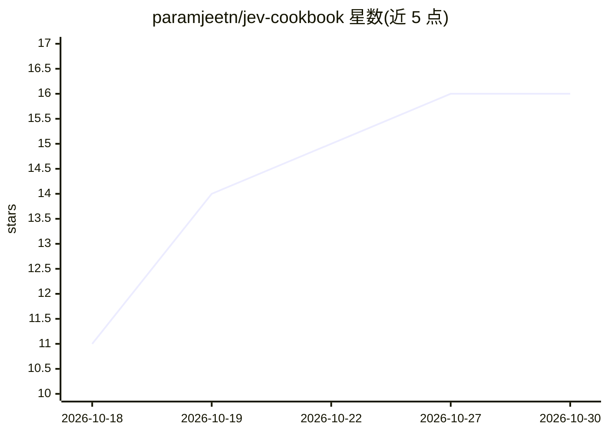

# paramjeetn/jev-cookbook

⭐ 16 · Python · MIT · 推送 2026-09-22 · [GitHub](https://github.com/paramjeetn/jev-cookbook) · 个人维护

**Jev 分类模型的用法手册：120+ 用例与可运行示例**

由个人维护的 TypeSafe AI Jev 模型 Cookbook：Jev 是校准零样本语义分类器，接收 state 与类型化 questions，返回概率分布而非生成文本，官方标称 ~100ms 响应。文档包含三种原语（Choice/Score/Noul）说明、10 个含 Python 脚本与 payload.json 的可运行示例、4 种组合模式（复合打分、置信度门控、投机扇出、混合 Agent 循环）、与 LLM 的指标对比表及常见错误排查。使用需在 console.typesafe.ai 获取 API key，无本地 SDK。

## 筛选速览

| 维度 | 判定 | 备注 |
|---|---|---|
| AI 角色 | `ai-knowledge` | 知识聚合/清单类 |
| 许可风险 | `permissive` | MIT |
| 部署形态 | `None` |  |
| 模型依赖 | — | README 未给出锁定关系 |
| 硬件要求 | — | 无带数字的原话,不猜 |
| 安装摩擦 | `low` | 无编译、无系统依赖或容器化 |
| 成熟度 | — | 结构信号不足 |

## 能力要点

- 覆盖 120+ 用例（USE_CASES.md，10 个领域）与 THEORY.md 一阶原理文档
- 10 个可运行示例，含实盘测试的财报交易信号抽取（~100ms）
- 三种原语（Choice/Score/Noul）与 4 种生产组合模式
- 与 GPT-4o 的延迟/成本/输出格式对比表

## 适用场景

- 我想为客服分诊、内容审核、欺诈检测等场景找分类方案
- 我想学习如何把快速分类器与 LLM 组合成混合 Agent
- 我想了解 Jev API 的 schema 与常见错误修复

## 场景标签

`教程课程` · 领域:学习与行业

## 证据(README 行号)

> L5:  120+ Use Cases
> L11:  Production-ready examples, patterns, and theory for building with Jev — the 100ms System One AI.
> L17: Jev is a "System One" AI model built by TypeSafe AI — a calibrated zero-shot semantic classifier, not a text genera

## 星数曲线

2026-10-18 11 → 2026-10-30 16（+5）

---
*卡片 v1 · prompt 1.4 · 生成 2026-10-30 · 置信度 high · 依据 README sha `c94963a9470e` · [字段定义](../../DATASET.md)*
