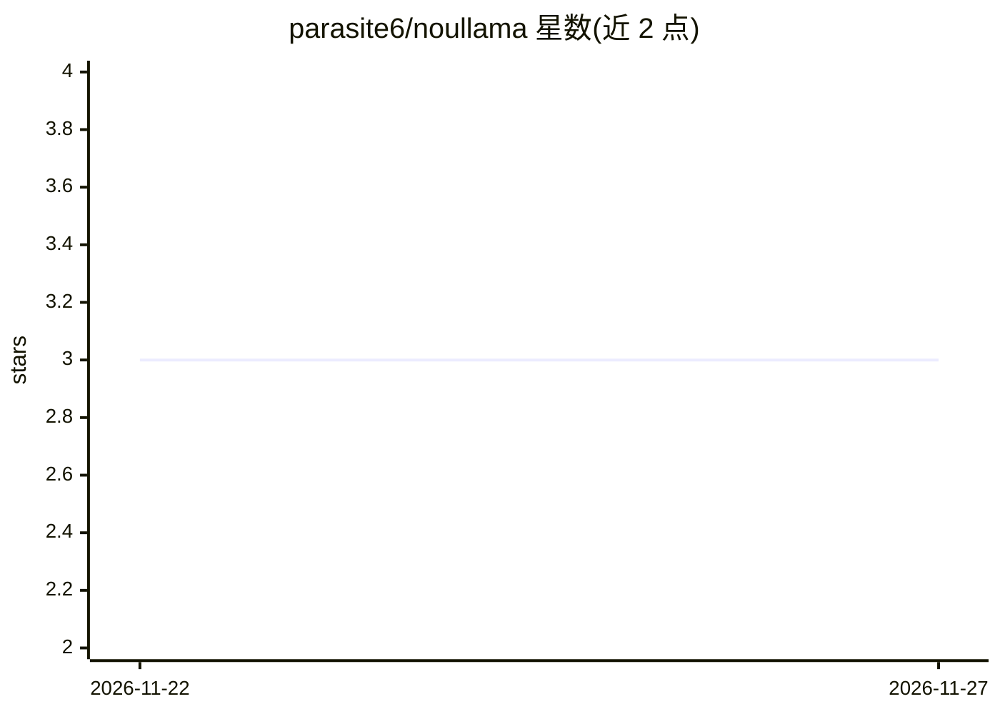

# parasite6/noullama

⭐ — · [GitHub]() · 个人维护

**本地决策模型工作台与 API，基于 llama.cpp 运行**

面向 Linux x86-64 桌面的本地应用，为决策模型（decision models）提供加载、运行与 API 服务：通过 Hub 搜索并下载 GGUF，管理多个 llama-server 进程并行加载、提供 OpenAI 风格的本地 `/v1` 接口，附带 Playground 编辑 state/questions 并运行决策。内置内存保护（加载前预算检查与 Linux 压力自动恢复）、模型库 models.yml 管理、MTP 与视觉支持。安装提供 deb/rpm 包，源码构建需 Node.js 24+ 与 Rust/Tauri 工具链。

## 筛选速览

| 维度 | 判定 | 备注 |
|---|---|---|
| AI 角色 | `ai-ecosystem` | LLM/agent 周边工具 |
| 许可风险 | `viral` | — |
| 部署形态 | `desktop` | 安装包/桌面程序 |
| 模型依赖 | local-ok | 支持本地模型 |
| 硬件要求 | — | 无带数字的原话,不猜 |
| 安装摩擦 | `medium` | 含编译或系统依赖之一 |
| 成熟度 | — | 结构信号不足 |

## 能力要点

- 多模型并行加载，每个模型独立 llama-server 进程与端口
- 本地 API 默认端点 `http://127.0.0.1:11435/v1`，支持模型别名路由
- 内存保护：加载前 OOM 预估检查与 Linux 内存压力自动恢复
- Hub 搜索决策模型仓库并经 Hugging Face CLI 下载 GGUF

## 适用场景

- 在本地桌面下载并运行 GGUF 决策模型
- 为客户端提供本地 OpenAI 风格 API 端点
- 同时加载多个模型并按内存预算管理
- 在 Playground 中编辑 state/questions 运行决策

## 场景标签

`推理引擎` · 领域:训练与推理

## 证据(README 行号)

> L6:  A local workbench and API for decision models using llama.cpp
> L77: - A compatible **llama-server**. Download builds under **Runtime → llama.cpp**, or use your own. Native decision mo

## 星数曲线

2026-11-22 3 → 2026-11-27 3（+0）

---
*卡片 v1 · prompt 1.4 · 生成 2026-11-22 · 置信度 high · 依据 README sha `6dcbad5d9ca0` · [字段定义](../../DATASET.md)*
