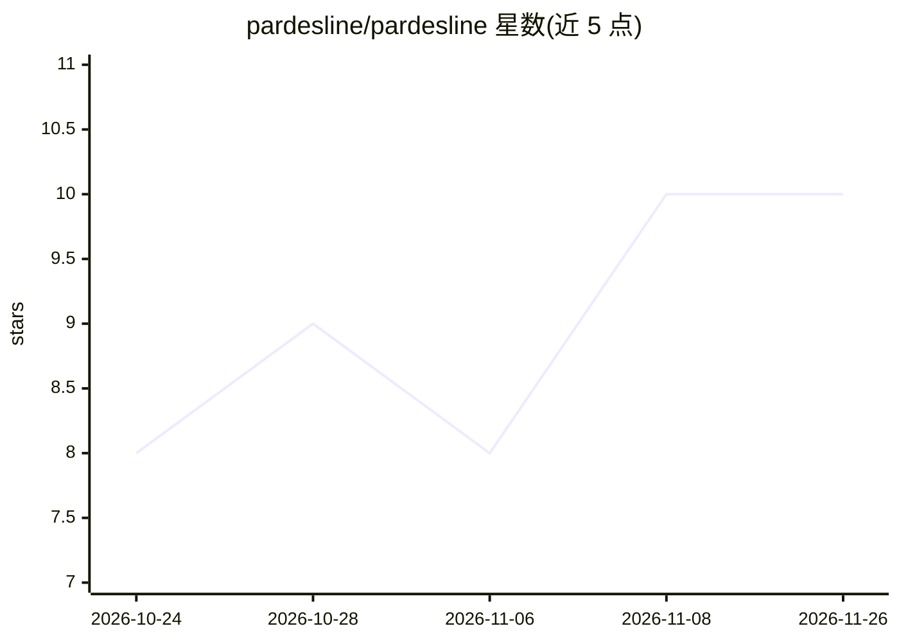

# pardesline/pardesline

⭐ 10 · Python · Apache-2.0 · 推送 2026-11-17 · [GitHub](https://github.com/pardesline/pardesline) · [官网](https://pardesline.github.io/pardesline/) · 个人维护

**给 3D 视觉与医学影像研究者的一行式数据集与算法 Python 包**

Python 库，用清单（manifest）描述 43 个公开 3D 与医学数据集，支持按需经 HTTP Range 惰性取样本并校验，许可与引用随数据携带；提供 73 个作用于点云、网格与 CT/MRI 体数据的算法，默认参数按数据自适应；以类型化对象（PointCloud/Mesh/Volume/LabelMap）在 Open3D、PyVista、SimpleITK 之间转换。附带 CLI、专家技能脚本与面向 AI agent 的本地 MCP server，提供 Apache-2.0 许可与引用文件。

## 筛选速览

| 维度 | 判定 | 备注 |
|---|---|---|
| AI 角色 | `ai-native` | 本体是模型或模型工具 |
| 许可风险 | `permissive` | Apache-2.0 |
| 部署形态 | `library` | 以包/库形式分发 |
| 模型依赖 | — | README 未给出锁定关系 |
| 硬件要求 | — | 无带数字的原话,不猜 |
| 安装摩擦 | `low` | 无编译、无系统依赖或容器化 |
| 成熟度 | — | 结构信号不足 |

## 能力要点

- 43 个数据集一行加载，HTTP Range 按需取样本（如 23 GB zip 仅索引 14 MB）
- 73 个算法统一调用，默认参数绑定数据（如体素尺寸由包围盒推导）并记录 sidecar
- 类型化对象在 Open3D / PyVista / SimpleITK 间互转并保留框架、单位与许可
- 提供 MCP server 与专家技能脚本（PointNet、DINOv3、JEPA、VAE、nnU-Net 准备）

## 适用场景

- 一行加载 TotalSegmentator、KiTS23 等医学分割数据集做训练与评估
- 在真实 CT 扫描上运行配准、分割、异常检测等 3D 算法
- 把医学影像工具通过 MCP 接入 AI agent 工作流
- 整合分散在 Zenodo、TCIA、Hugging Face 的 3D 数据源

## 场景标签

`科研工具` · 领域:学习与行业

## 证据(README 行号)

> L5:  Load 43 public 3D and medical datasets in one line, run 73 algorithms on point clouds, meshes and CT/MRI volumes wi
> L41: - **Datasets are scattered and incompatible.** The Decathlon is a tar on S3, TCIA is a REST API that returns zips o
> L54: pip install "pardesline[mcp]"          # + mcp: the local server for AI agents

## 星数曲线

2026-10-24 8 → 2026-11-26 10（+2）

---
*卡片 v1 · prompt 1.4 · 生成 2026-11-19 · 置信度 high · 依据 README sha `0688516364fb` · [字段定义](../../DATASET.md)*
